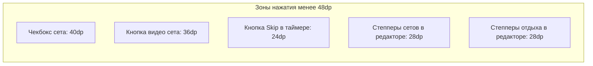

# Комплексный аудит системы (Full System Audit Report)
## Gym Workout Tracker — Независимая ревизия кодовой базы, продуктовой полноты и UX

> **Дата проведения аудита:** Ноябрь 2026  
> **Методология:** White-box инспекция исходного кода Kotlin/Room, компиляция Gradle (`testDebugUnitTest`), статический анализ Compose UI, сопоставление со спецификацией PRD и рыночный бенчмарк (Hevy, Strong, FitNotes, JEFIT).  
> **Статус:** Выявлены критические архитектурные расхождения, дефекты наполнения БД и эргономические риски.

---

## 1. Блок 1: Технический и кодовый аудит (Code & Database Truth Audit)

### 1.1. Критический баг автопосева базы данных (`DefaultTemplates.kt`)
- **Заявлено в чеклистах:** 4 готовые стартовые программы («Грудь + Трицепс (Push)», «Спина + Бицепс (Pull)», «Ноги + Плечи (Legs & Shoulders)», «Фулбоди (Full Body)») на 28+ упражнений с автопосевом в Room SQLite.
- **Фактическое состояние в коде:**
  - В приложении подключен полный каталог на 1324 упражнения (`core/database/src/main/assets/exercises_catalog.json`).
  - При первом старте метод `DefaultTemplates.seedDefaultDataIfEmpty` считывает каталог и ищет упражнения по жестко захардкоженным строкам: `exercisesMap["Жим гантелей на наклонной скамье"]`, `exercisesMap["Сведение рук в кроссовере"]`, `exercisesMap["Подтягивания широким хватом"]` и т.д.
  - **13 из 16 названий не совпадают с названиями в основном каталоге `exercises_catalog.json`!**
  - Из-за вызова `listOfNotNull(...)` все несовпавшие упражнения молча отбрасываются.
- **Фактический состав программ при чистой установке:**
  - **Push (Грудь + Трицепс):** вместо 5 упражнений создается **только 1** («Жим штанги лежа»). 4 упражнения потеряны.
  - **Pull (Спина + Бицепс):** создается **0 упражнений** (пустой шаблон!).
  - **Legs & Shoulders (Ноги + Плечи):** создается **только 2 упражнения** из 5.
  - **Full Body (Фулбоди):** создается **только 2 упражнения** из 6.
- **Причина:** Имена в шаблонах были скопированы из резервного файла `DefaultExercises.kt` (28 упражнений), а не из эталонного JSON-каталога (1324 упражнения).

---

### 1.2. «Фантомные» функции и разорванные сценарии (Declared vs Implemented)

1. **Кабинет тренера: жесткий хардкод пустого списка:**
   - В DAO `CoachAndReviewDao` реализован метод `getPendingReviewsForCoach(): Flow<List<SetVideoReviewEntity>>`.
   - Однако в `GymNavHost.kt` (строка 154) экран тренера вызывается со статическим пустым списком:
     ```kotlin
     composable(Destinations.COACH_REVIEWS) {
         CoachReviewScreen(
             reviews = emptyList(), // <--- Жесткий хардкод!
             onBackClick = { navController.popBackStack() },
             ...
         )
     }
     ```
   - Ни в одном месте приложения этот поток из DAO не передается в экран тренера. Экран тренера всегда пуст, даже если атлет записал видео подходов.

2. **Отсутствие экрана Истории тренировок (Workout History / Journal):**
   - В `WorkoutDao` есть развитые методы выборки: `getCompletedWorkouts()` и `getCompletedWorkoutsForUser("default_user")`.
   - Однако в UI и навигации (`GymNavHost`) **полностью отсутствует экран списка прошлых тренировок**. Пользователь не может открыть свою вчерашнюю тренировку, посмотреть список упражнений, поднятые веса или заметки. Данные о завершенных тренировках видны только в агрегированном виде на графиках аналитики.

3. **Отсутствие экрана итогов тренировки (Workout Summary Screen):**
   - При завершении тренировки (`finishWorkout`) в `GymNavHost` вызывается:
     ```kotlin
     onFinishClick = {
         navController.popBackStack(Destinations.TEMPLATES_LIST, inclusive = false)
     }
     ```
   - Пользователя мгновенно выбрасывает в список шаблонов. Нет экрана сводки: сколько тонн поднято, сколько подходов закрыто, какие рекорды (PR) установлены, какова итоговая длительность.

4. **Невозможность отменить или сбросить ошибочно начатую тренировку:**
   - В `WorkoutViewModel` есть только `finishWorkout(workoutId: Long)`.
   - Метода `cancelWorkout()` или `discardWorkout()` нет. Если пользователь случайно нажал «Старт», тренировку нельзя удалить — она навсегда сохраняется в БД как `COMPLETED` с нулевым объемом и портит статистику.

5. **Потеря фокуса активной тренировки при выходе в список шаблонов:**
   - Если во время активной тренировки пользователь вернулся назад на экран `TemplatesListScreen`, на главном экране **нет баннера активной тренировки** («Идет тренировка... Нажмите, чтобы вернуться»). Пользователь теряет доступ к открытой сессии.

6. **Хардкод идентификатора пользователя (`userId = "default_user"`):**
   - В `WorkoutViewModel` и `AnalyticsViewModel` запросы к БД жестко завязаны на строку `"default_user"`. Созданная в Фазе 0 таблица `user_profiles` и реальный профиль пользователя не связаны с логикой сохранения тренировок.

---

### 1.3. Поиск по каталогу упражнений (`ExercisesViewModel`)
- В строке 54 `ExercisesViewModel.kt`:
  ```kotlin
  val matchesQuery = query.isBlank() || exercise.name.contains(query, ignoreCase = true)
  ```
- Поле `exercise.nameEn` полностью игнорируется в поиске. При вводе англоязычных названий («Deadlift», «Bench press», «Squat», «Biceps curl») поиск возвращает 0 результатов, несмотря на то что в `exercises_catalog.json` все 1324 упражнения содержат `nameEn`.

---

### 1.4. Аудит тестового покрытия (Test Coverage)
- Команда `./gradlew testDebugUnitTest` успешно проходит, однако детальный отчет выявил:
  - `:core:database:testDebugUnitTest` — **NO-SOURCE (0 тестов)**. Нет тестов Room DAO, миграций и каскадных удалений.
  - `:feature:workout:testDebugUnitTest` — **NO-SOURCE (0 тестов)**. Сердце приложения (`WorkoutViewModel`, `RestTimerService`, `LiveWorkoutScreen`) полностью без автоматических тестов.
  - `:feature:exercises:testDebugUnitTest` — **NO-SOURCE (0 тестов)**.
  - `:app:testDebugUnitTest` — **NO-SOURCE (0 тестов)**.
  - Покрыты тестами только формулы в `:core:model` (`AnalyticsCalculatorTest`, `SmartProgressionEngineTest`, `UserProfileTest`) и один тест онбординга (`OnboardingViewModelTest`).

---

## 2. Блок 2: Бенчмарк с лидерами рынка (Hevy, Strong, FitNotes, JEFIT)

| Функциональный блок | Hevy / Strong | FitNotes | Наше приложение (Текущее состояние) | Статус паритета |
|---|---|---|---|---|
| **Свободная тренировка (Empty/Quick Workout)** | Запуск в 1 тап с главного экрана | Да, в 1 тап | **Отсутствует.** Тренировку можно начать только из заранее созданного шаблона. | ❌ Критический гэп |
| **Инлайн-ввод веса и повторов** | Прямо в строке таблицы (числовая клавиатура / степпер) | Быстрый диалог / инлайн | **Всплывающий `SetEditDialog`** с подтверждением по кнопке «Сохранить». | ❌ Высокое трение |
| **Калькулятор блинов (Plate Calculator)** | Встроен в каждый подход со штангой | Нет | **Отсутствует.** | ⚠️ Желательно |
| **Умная замена тренажера (Smart Swap)** | Ручная замена с сохранением веса | Замена упражнения | Заявлено в ADR-004, в коде `LiveWorkoutScreen` **нет кнопки замены**. | ❌ Не реализовано |
| **Дневник / Календарь тренировок** | Полноценный календарь + лента | Календарь + история | В Room DAO есть методы, **в UI экрана нет**. | ❌ Критический гэп |
| **Редактирование завершенной тренировки** | Да (исправление опечаток в истории) | Да | **Нет.** Завершенная тренировка неизменяема в UI. | ⚠️ Гэп |
| **Справочник упражнений в главном меню** | Отдельная вкладка в Bottom Navigation | Отдельный раздел | Доступен **только как селектор** при добавлении в шаблон/тренировку. | ❌ Архитектурный гэп |
| **GIF / Видео техники** | GIF / 3D-анимации | Текстовые инструкции | **1324 упражнения с GIF-анимациями (GymVisual/CDN)** + Coil кэш. |  Преимущество |
| **Фоновый таймер отдыха** | Шторка + звук/вибро | Звук/вибро | **Android Foreground Service (`RestTimerService`)** с кнопками `+30с` и вибро. |  Преимущество |
| **Платформа «Тренер — Клиент» (Видеорецензии)** | Нет | Нет | **Запись видео до 60с (Media3 ExoPlayer)** + 1–5 звезд (требуется связать с UI). |  Уникальное УТП |
| **Автопрогрессия с учетом оборудования зала** | Статичный шаг веса | Нет | **`SmartProgressionEngine`** с учетом RPE, стажа и дискретности снарядов. |  Уникальное УТП |
| **Резервное копирование / Экспорт** | Облако + CSV экспорт | Локальный CSV / Google Drive | **Отсутствует.** (Запланировано на Фазу 6). | ⚠️ В очереди |

---

## 3. Блок 3: Аудит удобства пользователей и эргономики (Gym Usability & Ergonomics)

### 3.1. Информационная архитектура и навигация
- **Проблема:** Главный экран `TemplatesListScreen` выполняет роль единственного хаба приложения. В `TopAppBar` втиснуты 4 разнородные иконки: профиль, аналитика, тренер и настройки оборудования.
- **Рыночный стандарт (Fitts's Law & Mobile UX):** Отсутствует классический **Bottom Navigation Bar**. Пользователь не может в 1 клик переключаться между базовыми сущностями:
  1. *Тренировка / Шаблоны*
  2. *Дневник / История*
  3. *Каталог упражнений*
  4. *Аналитика*
  5. *Профиль / Тренер*

---

### 3.2. Аудит интерактивных зон (Touch Targets < 48dp)
По правилу 3 `AGENTS.md` и гайдлайнам Google Material Design минимальный размер зоны нажатия в спортивном приложении обязан составлять **не менее 48×48dp**. 

В результате статического анализа выявлено **13 интерактивных элементов с нарушением стандарта**:



| Файл | Строка | Текущий размер | Элемент | Риск в условиях зала |
|---|---|---|---|---|
| `LiveWorkoutScreen.kt` | 590 | **40dp** | Чекбокс завершения подхода | Промахи по кнопке влажными/уставшими пальцами. |
| `LiveWorkoutScreen.kt` | 576 | **36dp** | Иконка видеокамеры подхода | Сложно нажать одной рукой. |
| `LiveWorkoutScreen.kt` | 344 | **24dp** | Кнопка «Пропустить» (Skip) таймера | Критически мелкая кнопка (24dp) для экрана активной тренировки. |
| `TemplateEditorScreen.kt` | 407, 428 | **28dp** | Степперы `[-]` и `[+]` количества подходов | Экстремально маленькие кнопки (28dp). |
| `TemplateEditorScreen.kt` | 448, 469 | **28dp** | Степперы `[-15с]` и `[+15с]` времени отдыха | Сложно попасть даже в спокойном состоянии. |
| `CreateExerciseDialog.kt` | 236, 254 | **40dp** | Кнопки регулировки времени отдыха | На 8dp меньше стандарта. |
| `SetTypeBadge.kt` | 41 | **36dp** | Бейдж смены типа подхода | Затрудняет переключение на дропсет/разминку. |

---

### 3.3. Трение при вводе данных (Data Input Friction)
- **Проблема `SetEditDialog`:** При нажатии на плашку веса или повторений открывается модальное всплывающее окно `AlertDialog`. Чтобы изменить вес, атлет должен:
  1. Нажать на вес;
  2. Дождаться открытия диалога;
  3. Ввести вес через клавиатуру или кликать мелкие кнопки `+2.5`;
  4. Проскроллить вниз диалога;
  5. Нажать кнопку «Сохранить».
- **Это напрямую нарушает концепцию быстрого логирования в 1 тап.**
- **Решение:** Инлайн-редактирование прямо в строке сета с автофокусом и кнопкой `ImeAction.Next` на софтверной клавиатуре.

---

### 3.4. Визуальные и информационные замечания экрана активной тренировки (`LiveWorkoutScreen`)
- **Замечание 1 (Отсутствие иконки упражнения):** В карточке `WorkoutExerciseCard` отображался только текстовый заголовок без миниатюры снаряда или GIF-превью. Устранено: добавлен компонент `ExerciseThumbnail` (48×48dp).
- **Замечание 2 (Блокировка просмотра техники и описания):** Атлет во время тренировки не мог кликнуть на упражнение, чтобы прочитать исходное положение, частые ошибки или посмотреть GIF-анимацию. Устранено: заголовок карточки сделан кликабельным с иконкой подсказки `Icons.Default.Info`, открывающим полноэкранный `ExerciseDetailSheet`.

---

## 4. Сводный Backlog доработок (Prioritized Action Plan)

### Приоритет P0 (Блокирующие баги и базовый функционал):
1. **Починить автопосев шаблонов в `DefaultTemplates.kt`:** привести названия упражнений в полное соответствие с `exercises_catalog.json`, чтобы стартовые сплиты (Push, Pull, Legs, FullBody) были полностью укомплектованы.
2. **Подключить поток видеоотзывов в `CoachReviewScreen`:** заменить `reviews = emptyList()` на реальный сбор из `CoachAndReviewDao.getPendingReviewsForCoach()`.
3. **Реализовать запуск «Свободной тренировки» (Start Empty Workout):** добавить кнопку быстрого старта без шаблона на главный экран и метод `startEmptyWorkout()` в `WorkoutViewModel`.
4. **Увеличить все интерактивные Touch Targets до $\ge$ 48dp:**
   - Чекбокс подхода `40dp` $\to$ `48dp` (или `48x48dp` с `minimumInteractiveComponentSize`);
   - Кнопка видео `36dp` $\to$ `48dp`;
   - Кнопка Skip таймера `24dp` $\to$ `48dp`;
   - Степперы в конструкторе шаблонов `28dp` $\to$ `48dp`.

### Приоритет P1 (Критическое удобство и юзабилити):
1. **Внедрить классический Bottom Navigation Bar:**
   - 4–5 вкладок: *Тренировка*, *История*, *Каталог*, *Аналитика*, *Профиль*.
2. **Создать экран «История тренировок» (Workout History):** отображение списка завершенных тренировок из Room DAO с возможностью просмотра деталей.
3. **Добавить баннер активной тренировки на главный экран:** чтобы атлет мог в любой момент вернуться в экран `LiveWorkoutScreen`.
4. **Реализовать инлайн-ввод подходов:** избавиться от блокирующего модального `SetEditDialog`.
5. **Добавить экран сводки завершенной тренировки (`WorkoutSummaryScreen`):** поздравление, тоннаж, время, новые PR.
6. **Добавить отмену/сброс тренировки (`discardWorkout`):** удаление ошибочно начатой тренировки.
7. **Включить `nameEn` в поиск упражнений в `ExercisesViewModel`.**

### Приоритет P2 (Стабильность и качество):
1. **Написать Unit-тесты для Room DAO и `WorkoutViewModel`:** закрыть нулевое покрытие в `:feature:workout` и `:core:database`.
2. **Экспорт и импорт базы (JSON/CSV backup).**
