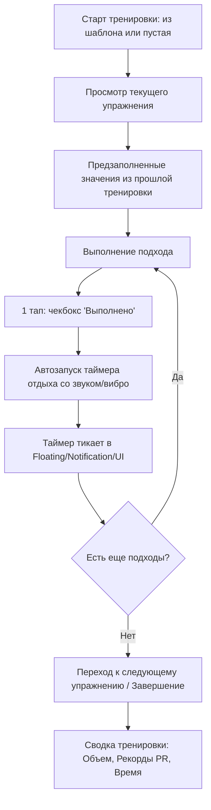

# Product Requirements Document (PRD) — Gym Workout Tracker

> **Document Version:** 1.0.0  
> **Author:** Fullstack Android Lead & Product Analyst  
> **Status:** Draft / Active  

---

## 1. Контекст и Проблематика (Domain Analysis)

### 1.1. Боли пользователей существующих решений (Strong, Hevy, JEFIT, FitNotes)
1. **Медленный ввод во время подхода:** Атлет находится под физической нагрузкой, пульс высокий, руки могут быть в магнезии/перчатках. Приложения требуют слишком много тапов (подтвердить вес, подтвердить повторения, закрыть всплывающее окно).
2. **Проблемы со связью в зале:** Большинство фитнес-клубов находятся в цокольных этажах или в глубине ТЦ с экранированными бетонными перекрытиями. Облачные приложения часто зависают или теряют несохраненные подходы при сбоях сети.
3. **Платные базовые функции:** Ограничение на количество шаблонов (например, лимит 3 шаблона в бесплатном тарифе Strong/Hevy) раздражает пользователей.
4. **Сложность работы с суперсетами и дропсетами:** Во многих трекерах сложно объединить 2-3 упражнения в один блок с чередующимся отдыхом.

### 1.2. Продуктовое видение (Product Vision)
Создать легковесный, надежный и максимально отзывчивый трекер, ориентированный на **быстроту взаимодействия во время тренировки**, 100% стабильную работу **офлайн** и глубокую аналитику прогресса без лишнего визуального мусора.

---

## 2. Целевая аудитория (User Personas)

1. **"Систематический атлет" (Intermediate / Advanced Lifter):**
   - Тренируется 3-5 раз в неделю по сплитам или Full-Body.
   - Важно: фиксация RPE/RIR, весов, типов сетов (дропсеты, разминка), предыдущие показатели прямо перед глазами, расчет 1RM, авто-таймер отдыха.
2. **"Начинающий" (Beginner):**
   - Тренируется по готовым шаблонам или рекомендациям тренера.
   - Важно: встроенный справочник упражнений с анимацией/техникой выполнения, подсказка, какой вес ставился в прошлый раз.
3. **"Минималист" (Old-school athlete):**
   - Переходит с бумажного блокнота.
   - Важно: простота интерфейса, отсутствие рекламы и лишних соцсетей, скорость.

---

## 3. Ключевые сценарии использования (User Journeys)

### Journey 1: "Активная тренировка" (Core Loop — In-Workout)

### Journey 2: "Конструктор шаблонов" (Pre-Workout)
- Создание шаблона: "День А — Грудь/Трицепс", "День B — Спина/Бицепс", "День C — Ноги/Плечи".
- Добавление упражнений из каталога или создание кастомного упражнения.
- Настройка суперсетов (например: Подтягивания + Брусья).
- Установка целевых подходов, повторений и дефолтного времени отдыха.

### Journey 3: "Анализ прогресса" (Post-Workout)
- График тоннажа (общий поднятый вес за тренировку / за неделю).
- График 1RM (Epley / Brzycki формулы) по базовым упражнениям (жим, присед, становая тяга, армейский жим).
- Календарь тренировок (Heatmap активности).

---

## 4. Функциональные требования (Functional Requirements)

### 4.1. Модуль упражнений (Exercise Catalog)
- [FR-1.1] Предустановленная база стандартных упражнений (>100 упражнений) с фильтрацией по мышечным группам (Грудь, Спина, Квадрицепс, Бицепс бедра, Плечи, Руки, Кор) и инвентарю (Штанга, Гантели, Тренажер, Собственный вес, Блоки).
- [FR-1.2] Возможность создания кастомных упражнений пользователем.
- [FR-1.3] История и персональные рекорды (PR) по каждому упражнению.

### 4.2. Модуль ведения тренировки (Live Workout Logger)
- [FR-2.1] Поддержка типов подходов:
  - `Normal` (Рабочий)
  - `Warmup` (Разминочный — не учитывается в рабочем объёме PR)
  - `Drop` (Дропсет)
  - `Failure` (До отказа)
- [FR-2.2] Авто-подстановка данных из аналогичного подхода предыдущей тренировки.
- [FR-2.3] Поддержка суперсетов (группировка 2+ упражнений с цветовым маркером).
- [FR-2.4] Возможность корректировать вес и повторы в 1 клик (кнопки +/- или инкрементные колесики/быстрый ввод).
- [FR-2.5] Заметки к упражнению/подходу (например: "поднять сиденье на уровень 4").

### 4.3. Таймер отдыха (Rest Timer)
- [FR-3.1] Автостарт при чекбоксе завершения сета.
- [FR-3.2] Настраиваемое время по умолчанию для каждого упражнения (напр. 3 мин на присед, 90 сек на бицепс).
- [FR-3.3] Работа в фоне: уведомление со статус-баром, звуковой сигнал и тактильный отклик (Haptic Feedback) по окончании.
- [FR-3.4] Быстрые кнопки добавления/вычитания времени (+30с, -15с, Skip).

### 4.4. Модуль аналитики и метрик
- [FR-4.1] Расчет Estimated 1RM (по формуле Brzycki / Epley).
- [FR-4.2] Расчет суммарного объема (Volume = $\sum \text{weight} \times \text{reps}$).
- [FR-4.3] Фиксация Personal Records (Max Weight, Max Volume, Max Reps).

### 4.5. Модуль "Тренер — Клиент" (Coach & Athlete Platform)
- [FR-5.1] Ролевая модель: переключение профиля "Атлет" / "Тренер".
- [FR-5.2] Назначение программ: тренер составляет шаблон и назначает его клиенту с целевыми весами, диапазоном повторов (напр. 8-10) и целевым RPE.
- [FR-5.3] Видеоотчеты по технике (Form Check Video):
  - Атлет может прикрепить видео к конкретному подходу (запись через камеру или выбор из галереи).
  - Тренер получает уведомление о завершенной тренировке и может просмотреть видео подхода.
  - Тренер оставляет текстовые замечания и оценку техники с привязкой к подходу.

### 4.6. Умная автопрогрессия весов и профили тренажеров
- [FR-6.1] Алгоритм адаптивной прогрессии нагрузки (Double Progression): авто-расчет веса на следующую тренировку при успешном выполнении целевых повторений.
- [FR-6.2] Настройки дискретности весов оборудования (Equipment Step Settings):
  - Гантели: раздельные шаги для малых весов (< 10 кг — шаг 1 кг) и тяжелых весов (> 10 кг — шаг 2 кг).
  - Блочные тренажеры: шаг стека (2.5 кг / 5.0 кг) с поддержкой микро-довесков (1.25 кг).
  - Штанга: учет веса грифа (20 кг / 15 кг / EZ) и доступного набора блинов.
  - Возможность кастомизировать шаг веса для любого отдельного упражнения в его настройках.

---

## 5. Нефункциональные требования (NFR)
- **Offline-First:** 100% функций логирования и чтения истории работают без подключения к интернету.
- **Производительность:** Холодный старт < 1.5 сек, переключение экранов 60-120 fps, никаких ANR при работе с базой данных.
- **Энергоэффективность:** Dark Theme по умолчанию (AMOLED-friendly), минимизация работы процессора в фоне при активном таймере.
- **Удобство ввода (Ergonomics):** Крупные hit-зоны для кнопок (не менее 48dp), доступность для работы одной рукой.
- **Надежность данных:** Автосохранение каждого действия в локальную БД. Даже при неожиданной перезагрузке телефона тренировка восстанавливается в том же состоянии.
