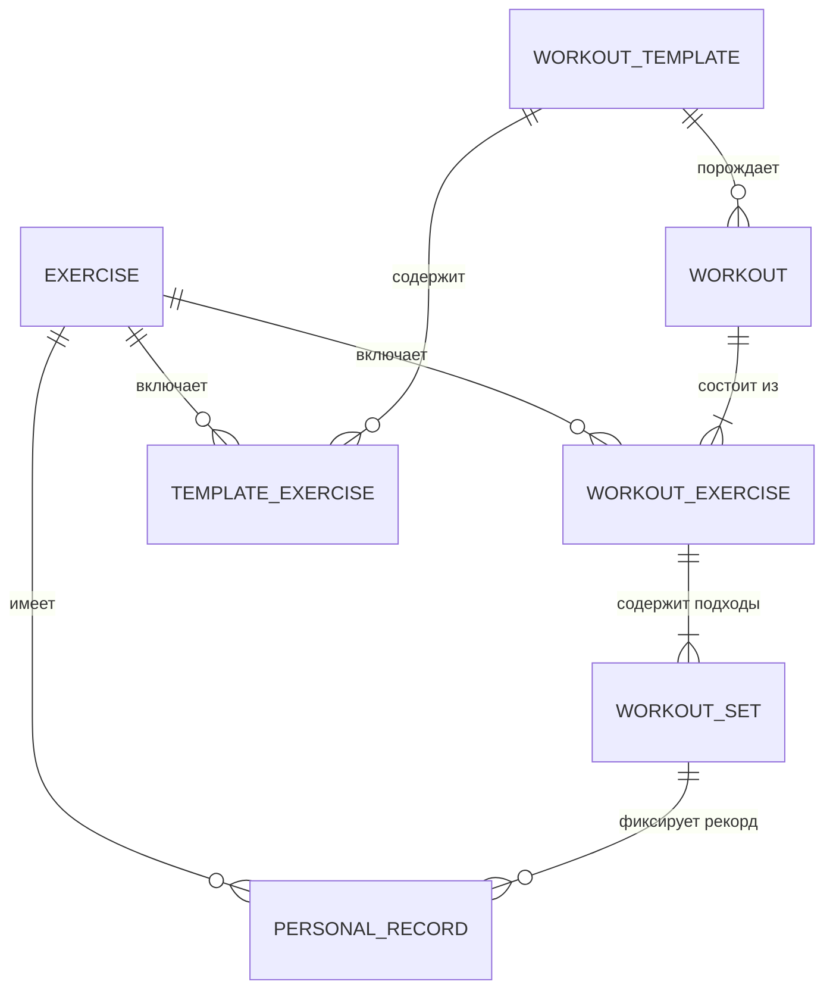

# Domain Model & Database Schema Specification

> **Document Version:** 1.0.0  
> **Status:** Draft / Active  

---

## 1. Концептуальная диаграмма сущностей (ERD)

---

## 2. Детальная спецификация сущностей

### 2.1. `Exercise` (Упражнение)
Справочник упражнений (как встроенных базовых, так и кастомных пользовательских).
- `id: UUID / Long` (PK)
- `name: String` (Например: "Жим штанги лежа")
- `primaryMuscleGroup: Enum` (CHEST, BACK, LEGS_QUADS, LEGS_HAMSTRINGS, SHOULDERS, BICEPS, TRICEPS, CORE, CALVES, FULL_BODY)
- `secondaryMuscleGroups: List<Enum>` (Вспомогательные мышцы)
- `equipment: Enum` (BARBELL, DUMBBELL, MACHINE, CABLE, BODYWEIGHT, RESISTANCE_BAND, KETTLEBELL, OTHER)
- `category: Enum` (WEIGHT_REPS, REPS_ONLY, TIME_DISTANCE, WEIGHT_TIME)
- `isCustom: Boolean` (false — предустановлено, true — создано пользователем)
- `defaultRestTimeSeconds: Int` (Например: 120)
- `instructions: String?` (Краткое описание биомеханики)

---

### 2.2. `WorkoutTemplate` & `TemplateExercise` (Шаблоны тренировок)
Заготовки тренировок (например: "День тяги", "Верх тела").
- **WorkoutTemplate:**
  - `id: Long` (PK)
  - `title: String`
  - `description: String?`
  - `createdAt: Long` (Timestamp)
  - `lastUsedAt: Long?`
- **TemplateExercise:**
  - `id: Long` (PK)
  - `templateId: Long` (FK -> WorkoutTemplate.id)
  - `exerciseId: Long` (FK -> Exercise.id)
  - `orderIndex: Int` (Порядок следования)
  - `supersetId: String?` (UUID группы суперсета: упражнения с одинаковым supersetId выполняются в паре)
  - `targetSetsCount: Int`
  - `defaultRestSeconds: Int`

---

### 2.3. `Workout` (Сессия тренировки)
Конкретная выполненная или текущая сессия.
- `id: Long` (PK)
- `templateId: Long?` (FK -> WorkoutTemplate.id, nullable если тренировка начата "с нуля")
- `title: String` (Например: "Вечерняя тренировка спины")
- `startTime: Long` (Timestamp старта)
- `endTime: Long?` (Timestamp завершения, null пока тренировка активна)
- `durationSeconds: Long` (Чистое время)
- `totalVolumeKg: Double` (Суммарный объем = $\sum weight \times reps$)
- `totalSetsCompleted: Int`
- `status: Enum` (IN_PROGRESS, COMPLETED, CANCELLED)
- `notes: String?`

---

### 2.4. `WorkoutExercise` (Упражнение в рамках тренировки)
Экземпляр упражнения в конкретной сессии.
- `id: Long` (PK)
- `workoutId: Long` (FK -> Workout.id, ON DELETE CASCADE)
- `exerciseId: Long` (FK -> Exercise.id)
- `orderIndex: Int`
- `supersetId: String?`
- `notes: String?`

---

### 2.5. `WorkoutSet` (Подход)
Минимальная единица учета нагрузки.
- `id: Long` (PK)
- `workoutExerciseId: Long` (FK -> WorkoutExercise.id, ON DELETE CASCADE)
- `setNumber: Int` (1, 2, 3...)
- `setType: Enum`
  - `NORMAL` (Стандартный рабочий)
  - `WARMUP` (Разминка — не учитывается в расчете PR и рабочих метрик)
  - `DROP` (Дропсет)
  - `FAILURE` (До отказа)
- `weight: Double` (Вес отягощения в кг или фунтах)
- `reps: Int` (Количество повторений)
- `rpe: Float?` (Rate of Perceived Exertion, от 6.0 до 10.0, опционально)
- `isCompleted: Boolean` (Флаг выполнения: true при нажатии галочки)
- `completedAt: Long?` (Timestamp момента выполнения)
- `restTimeSeconds: Int?` (Фактически затраченное время отдыха)

---

### 2.6. `PersonalRecord` (Личные рекорды)
- `id: Long` (PK)
- `exerciseId: Long` (FK -> Exercise.id)
- `workoutId: Long` (FK -> Workout.id)
- `setId: Long` (FK -> WorkoutSet.id)
- `recordType: Enum` (MAX_WEIGHT, MAX_VOLUME, ESTIMATED_1RM, MAX_REPS)
- `value: Double`
- `achievedAt: Long`

### 2.7. `EquipmentWeightProfile` & `ExerciseWeightStep` (Настройки шага оборудования)
- **EquipmentWeightProfile:**
  - `equipmentType: Equipment`
  - `smallWeightThresholdKg: Double` (Например: 10.0 кг)
  - `smallWeightStepKg: Double` (Например: 1.0 кг для гантелей $\le 10$ кг)
  - `regularStepKg: Double` (Например: 2.0 кг для гантелей $> 10$ кг, или 2.5/5.0 кг для блоков)
  - `barbellBarWeightKg: Double` (20.0 кг)
  - `availablePlates: List<Double>` ([25.0, 20.0, 15.0, 10.0, 5.0, 2.5, 1.25, 0.5])

### 2.8. `SetVideoAttachment` & `CoachFeedback` (Видеоотчеты и рецензии тренера)
- **SetVideoAttachment:**
  - `id: Long` (PK)
  - `setId: Long` (FK -> WorkoutSet.id)
  - `localUri: String` (Локальный путь к видеофайлу на устройстве)
  - `remoteUrl: String?` (Облачный URL при наличии синхронизации)
  - `durationMs: Long`
  - `createdAt: Long`
- **CoachFeedback:**
  - `id: Long` (PK)
  - `setId: Long` (FK -> WorkoutSet.id)
  - `coachId: String`
  - `comment: String` (Замечание тренера, напр. "Локти уходят назад в нижней точке")
  - `rating: Int` (Оценка техники 1..5)
  - `createdAt: Long`

---

## 3. Бизнес-формулы и правила расчета

### 3.1. Расчет одноповторного максимума (Estimated 1RM)
Используем формулу **Epley** для повторений $\le 10$:
$$1\text{RM} = \text{weight} \times \left(1 + \frac{\text{reps}}{30}\right)$$
Или формулу **Brzycki**:
$$1\text{RM} = \text{weight} \times \frac{36}{37 - \text{reps}}$$

### 3.2. Расчет рабочего объема (Volume)
$$\text{Volume} = \sum_{s \in \text{Sets}} (\text{weight}_s \times \text{reps}_s) \quad \text{где } \text{setType} \neq \text{WARMUP}$$
Разминочные сеты исключаются из аналитики прогресса силовой выносливости, чтобы не искажать рабочий тоннаж.
