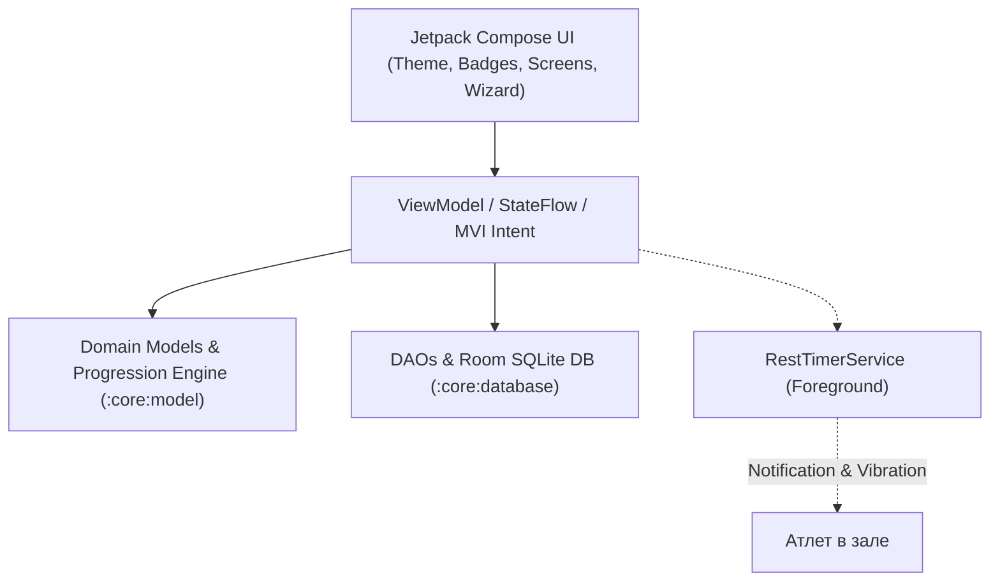
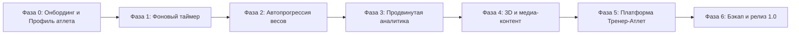

# 🏋️ Gym Workout Tracker — Генеральный стратегический план проекта до релиза 1.0

> **Документ:** Стратегический мастер-план разработки, архитектуры и продуктового видения.  
> **Версия:** 1.1.0-PROD-PLAN  
> **Статус:** Активный рабочий план  

---

## 1. Миссия проекта и продуктовая стратегия

### 1.1. Главная миссия
Создать **самый эргономичный, надежный и автономный мобильный трекер силовых тренировок** для атлетов любого уровня: от новичков до соревнующихся пауэрлифтеров и бодибилдеров, а также их персональных тренеров.

### 1.2. Проблемы существующих приложений и наши решения (Problem-Solution Matrix)

| Проблема на рынке | Реальность в тренажерном зале | Наше стратегическое решение |
|---|---|---|
| **Отсутствие персонализации на старте** | Новички и опытные атлеты получают один и тот же шаблон без учета пола, веса, стажа и целей. Новички перегружаются и бросают, профи недополучают стимула. | **Phase 0 Smart Onboarding:** Интерактивная анкета первого входа (рост, вес, пол, стаж, цель, частота в неделю). Авторасчет ИМТ и генерация персонализированного тренировочного сплита. |
| **Зависимость от облака/интернета** | В подвальных/цокольных залах часто полностью пропадает мобильная сеть. Приложения виснут, блокируя логирование. | **100% Offline-First:** Вся база упражнений, шаблонов, истории и аналитики работает локально в Room SQLite. Интернет опционален — только для бэкапа и видео тренеру. |
| **Перегруженный интерфейс и кликабельный ад** | Мокрые от пота пальцы, учащенный пульс, трясущиеся руки после тяжелого сета. Мелкие поля ввода раздражают. | **Frictionless Ergonomics:** Завершение сета ровно в 1 тап. Touch Targets $\ge 48\text{dp}$. Умное каскадирование веса. Предзаполнение из прошлой тренировки. |
| **Сброс таймера при блокировке экрана** | Атлет блокирует телефон и кладет в карман во время отдыха — таймер засыпает или сбрасывается системой Android. | **Android Foreground Service:** Непрерывный отсчет времени с уведомлением в шторке и **тройным виброимпульсом** по окончании отдыха. |
| **Субъективное угадывание весов** | Спортсмены не помнят свои веса на прошлой неделе и повышают нагрузку наугад, получая травмы или застой. | **Smart Progression Engine:** Математический алгоритм двойной прогрессии (Double Progression + RPE/RIR) с учетом физиологии атлета и дискретности снарядов зала. |
| **Отсутствие контроля техники** | Дистанционные тренеры получают от подопечных тонны несвязанных сообщений в мессенджерах. | **Coach-Client Synergy:** Прямая фиксация видеоподхода (до 60 сек) внутри конкретного сета и выставление экспертной оценки 1–5 звезд с комментариями. |

---

## 2. Архитектурная модель системы

Проект построен на **Multi-Module Clean Architecture** с однонаправленным потоком данных (**MVI / UDF**):

### Модульная спецификация:
1. `:core:model` — чистый Kotlin (доменные сущности `UserProfile`, `Workout`, `Exercise`, формулы 1RM, алгоритмы прогрессии). Полная изоляция от Android SDK.
2. `:core:database` — Room Database 2.x, SQLite сущности (`UserProfileEntity`, `WorkoutEntity`), конвертеры, миграции, DAO с реактивными `Flow`.
3. `:core:ui` — дизайн-система приложения: высококонтрастная тема AMOLED Dark, бейджи суперсетов, бейджи типов сетов (W, D, F).
4. `:feature:templates` — экран онбординга атлета (`OnboardingScreen`), конструктор тренировок, суперсеты, управление подходами и временем отдыха, быстрый запуск.
5. `:feature:exercises` — база упражнений, фильтрация по анатомическим группам, FlowRow-чипсы, `ExerciseDetailSheet`.
6. `:feature:workout` — экран активной тренировки (`LiveWorkoutScreen`), фоновый сервис таймера (`RestTimerService`), видеофиксация техники, экран аналитики (`AnalyticsScreen`).
7. `:app` — сборка проекта, Koin DI модули, Compose NavHost с автоматическим определением стартового экрана (Onboarding vs Home).

---

## 3. Аудит текущего состояния проекта (Completed Milestones)

На текущий момент успешно спроектировано, реализовано и протестировано:
- [x] **Стабильность сборки и версий:** Официальный Gradle 8.13, AGP 8.13.2, Kotlin 2.0.21, KSP, Room 2.6.1. Все модули компилируются без ошибок.
- [x] **Базовый UI и MVI:** Экран шаблонов, конструктор тренировок, экран активной тренировки.
- [x] **Анатомические категории мышц:** Переход на понятные группы: Грудь, Спина, Ноги, Плечи, Бицепс, Трицепс, Кор/Пресс, Прочее.
- [x] **Адаптивная верстка:** FlowRow-чипсы, адаптирующиеся под любой масштаб экрана смартфона.
- [x] **Интерактивный ввод и умное каскадирование:** Редактирование веса/повторов через диалог со степперами. При изменении веса в сете $N$ все последующие незавершенные сеты автоматически наследуют этот вес.
- [x] **Секундомер и таймер отдыха:** Секундомер общей длительности тренировки в TopAppBar + таймер отдыха между подходами с быстрыми чипсами (+30с, -15с, 60с, 90с, 120с).
- [x] **Аналитика и 1ПМ (Sprint 5):** Экран `AnalyticsScreen` с расчетом 1RM по формуле Эпли, диаграмма распределения тоннажа по группам мышц, учет личных рекордов (PR) и фильтры по времени (7 дней, 30 дней, Всё время).
- [x] **Автопосев базы данных (Sprint 6):** Модуль `DefaultTemplates.kt` с 4 готовыми тренировками («Фулбоди», «Грудь+Трицепс», «Спина+Бицепс», «Ноги+Плечи») и 28+ упражнениями. Автоматическое восстановление при пустой базе.
- [x] **Удобный ввод названий:** Готовые чипсы популярных названий в редакторе шаблонов в 1 клик.
- [x] **Фоновый сервис таймера (`RestTimerService`):** Реализован Android Foreground Service с Ongoing Notification, кнопками `+30с` и `Пропустить` в шторке, и тройным виброоткликом через `VibrationEffect.createWaveform`.
- [x] **Доменная модель профиля атлета (`UserProfile`):** Сущность `UserProfile`, энумы `Gender`, `TrainingExperience`, `FitnessGoal`, расчет ИМТ (BMI) и автоматический выбор рекомендованной программы.
- [x] **Схема данных профиля:** `UserProfileEntity` и TypeConverters в `:core:database`.
- [x] **Экран онбординга атлета (`OnboardingScreen` & `OnboardingViewModel`):** 3-шаговый визард первого входа (Имя/Пол/Возраст -> Рост/Вес/ИМТ -> Опыт/Цель/Частота), чипсы быстрого выбора имени, сохранение в Room, динамический роутинг в `GymNavHost` и редактирование профиля по иконке в TopAppBar.
- [x] **Движок автопрогрессии нагрузок (`SmartProgressionEngine`):** Научно обоснованная авторегуляция весов и повторений под цели атлета (Гипертрофия, Сила, Похудение, Здоровье), физический шаг оборудования (`EquipmentWeightProfile`), учет RPE/RIR и интерактивный баннер `SmartProgressionBanner` в живой тренировке.
- [x] **Интерактивный веб-симулятор:** Полный симулятор `preview/index.html` для мгновенной проверки фичей в браузере.

---

## 4. Детальный пошаговый план до релиза 1.0

---

### 👤 Фаза 0: Онбординг, Профиль атлета и Персонализация программ
*Цель: Собрать физиологические и тренировочные параметры пользователя при первом запуске для интеллектуального подбора программ и расчета прогрессии.*

1. **Анкета первого входа (User Onboarding Flow):**
   - **Персональные данные:** Имя атлета, Пол (`Мужской` / `Женский`), Возраст.
   - **Антропометрия:** Рост (см), Текущий вес (кг).
     - Автоматический расчет **ИМТ (Индекса массы тела)**:
       $$\text{BMI} = \frac{\text{Weight (kg)}}{(\text{Height (m)})^2}$$
   - **Тренировочный стаж (Experience Level):**
     - *Новичок (< 6 месяцев):* упор на освоение базовой механики, программы Фулбоди 2-3 раза в неделю.
     - *Средний уровень (6 мес. — 2 года):* адаптация к сплитам (Push/Pull/Legs), линейная прогрессия весов.
     - *Продвинутый (2+ года):* работа с околопредельными весами, RPE/RIR авторегуляция, периодизация.
   - **Главная цель тренировок (Fitness Goal):**
     - Набор мышечной массы (Гипертрофия);
     - Увеличение силы (Силовые рекорды / Пауэрлифтинг);
     - Рельеф и снижение процента жира;
     - Здоровье, тонус и выносливость.
   - **Частота тренировок в неделю:** 2, 3, 4 или 5 дней.
2. **Архитектура хранения (`UserProfileEntity` в Room):**
   - Таблица `user_profiles` с локальным хранением всех параметров.
   - При первом запуске `GymNavHost` проверяет наличие профиля: если профиль пуст — открывается интерактивный экран анкетирования, после чего генерируются персональные рекомендации.
   - Возможность в любой момент обновить вес и цели в профиле (иконка профиля в верхнем баре).
3. **Автоподбор стартовой программы тренировок:**
   - На основе целей и частоты алгоритм автоматически рекомендует и закрепляет оптимальный стартовый шаблон:
     - Новичок + 2-3 дня = программа «⚡ Фулбоди (Full Body)»;
     - Средний + Набор массы = сплит «🥋 Грудь + Трицепс (Push)» / «🦅 Спина + Бицепс (Pull)» / «🦵 Ноги + Плечи (Legs)»;
     - Средний/Опытный + Сила = акцент на базовые компаундные движения.
4. **Связь с алгоритмом прогрессии:**
   - Антропометрия и стаж определяют стартовую агрессивность прогрессии: новичкам рекомендуется линейная прибавка к рабочему весу каждую неделю, продвинутым — шаг через микровеса и авторегуляция по RPE.

---

### 🚀 Фаза 1: Фоновый таймер отдыха и системные уведомления (Gym Foreground Service)
*Цель: Обеспечить надежный отсчет времени отдыха в кармане атлета при выключенном экране.*

1. **Android Foreground Service (`RestTimerService`):**
   - Создание сервиса с `ServiceCompat.startForeground` и типом `FOREGROUND_SERVICE_TYPE_SPECIAL_USE`.
   - Регистрация в `AndroidManifest.xml` с разрешениями `POST_NOTIFICATIONS` и `FOREGROUND_SERVICE`.
2. **Ongoing Notification (Уведомление в шторке Android):**
   - Интерактивное уведомление с живым счетчиком обратного отсчета секунд (`01:24... 01:23...`).
   - Кнопки быстрых действий прямо в шторке: `+30с` и `Пропустить отдых`.
3. **Тактильный движок (Haptic Engine):**
   - Вибрационный паттерн через `VibrationEffect.createWaveform`: тройной четкий виброимпульс при окончании времени отдыха.
   - Короткий тактильный щелчок (Tick) на последних 3 секундах обратного отсчета (3.. 2.. 1.. Вперед!).

---

### 🧠 Фаза 2: Алгоритм адаптивной автопрогрессии (Smart Progression Engine)
*Цель: Освободить спортсмена от высчитывания весов и гарантировать безопасный рост силы.*

1. **Интеграция `SmartProgressionEngine` в активную тренировку:**
   - Чтение предыдущих тренировок атлета из `workout_sets` (вес, повторения, оценка RPE).
   - Расчет рекомендации на текущую тренировку:
     - Если на прошлой тренировке закрыты все целевые повторения с усилием `OPTIMAL` / `EASY` -> рекомендация: **Повысить вес на шаг снаряда** (например, +2.5 кг для штанги, +1..2 кг для гантелей).
     - Если был `FAILURE` или `HARD` -> рекомендация: **Закрепить вес** для связочной адаптации.
     - Если атлет не дотянул до нижней планки повторений -> рекомендация: **Снизить вес на шаг снаряда**.
2. **UI-карточка рекомендации перед началом упражнения:**
   - Баннер в карточке упражнения с рекомендацией веса и кнопкой «Применить рекомендацию в 1 тап».
3. **Профиль шага оборудования (`EquipmentWeightProfile`):**
   - Учет параметров из `equipment_settings`: вес грифа (20 кг), минимальная пара блинов (1.25 / 2.5 кг), шаг стека блочного тренажера.

---

### 📈 Фаза 3: Глубокая аналитика и отслеживание прогресса (Advanced Analytics)
*Цель: Наглядный контроль динамики силы и предупреждение перетренированности.*

1. **Интерактивные графики прогресса (Jetpack Compose Canvas):**
   - График динамики 1RM по датам с линиями тренда.
   - График суммарного тоннажа по неделям (столбчатая диаграмма).
2. **Радарная диаграмма / тепловая карта мышц:**
   - Визуализация баланса нагрузки: выявление отстающих мышечных групп (например, мало спины при избытке груди).
3. **Личные рекорды (PR Trophies):**
   - Экран славы: лучший вес на 1, 3, 5, 10 повторений для каждого базового упражнения.

---

### 🎬 Фаза 4: Мультимедиа и каталог техники (Exercise Media Hub)
*Цель: Понятная биомеханика и визуализация правильной техники движения.*

1. **Наполнение карточек упражнений (`ExerciseDetailSheet`):**
   - Иллюстрации траектории движения и акцента мышечных пучков.
   - Пошаговые инструкции по дыханию, постановке стоп и положению лопаток.
2. **Медиа-контейнер (Sceneview 3D / Анимации):**
   - Подключение легких glTF/GLB 3D-моделей или зацикленных векторных анимаций с возможностью вращения снаряда.
3. **Конструктор пользовательских упражнений:**
   - Экран создания своего упражнения с выбором анатомической категории, снаряда и времени отдыха по умолчанию.

---

### 🤝 Фаза 5: Платформа Тренер-Атлет, Авторизация и Учет пакетов (Coach CRM & Auth Hub)
*Цель: Превратить трекер в полноценную экосистему наставничества для тренеров с пулом подопечных и гибким учетом абонементов.*

1. **Авторизация и ролевая модель (Auth & RBAC):**
   - Способы входа: Google Sign-In (Credential Manager), Email + Password, локальный гостевой режим.
   - Разделение ролей: `ROLE_ATHLETE` (Спортсмен) и `ROLE_COACH` (Тренер).
   - Связка Тренер-Подопечный: генерация персонального инвайт-кода / QR-кода / Deep Link тренером и ввод подопечным.
2. **Мульти-клиентский кабинет тренера (Coach Multi-Client CRM):**
   - **Пул подопечных (Client Roster):** список спортсменов с фильтрами («Активные», «Пропустили тренировку», «Заканчивается пакет»).
   - **Карточка подопечного:** антропометрия (рост, вес, динамика ИМТ), стаж, целевой сплит, травмы и ограничения по здоровью.
   - **Приватные заметки тренера:** скрытый от клиента блок заметок по нюансам работы и психологическим особенностям.
3. **Учет абонементов и тренировочных пакетов (Session Ledger):**
   - Назначение пакета сессий (например: 8, 10, 12 тренировок или безлимит на месяц).
   - Метрики: **Проведено**, **Осталось**, **Срок действия**.
   - Автоматическое или подтверждаемое списание тренировки после завершения занятия подопечным.
   - Уведомления тренеру и клиенту («Осталось 1-2 тренировки») для своевременного продления.
4. **Назначение программ и лента аудита:**
   - Составление и прикрепление тренировочных шаблонов конкретным клиентам.
   - Лента выполнения: просмотр фактически взятых весов, тоннажа, RPE и пропущенных подходов.
5. **Видеоаудит техники (Form Check Video Review):**
   - Бесшовный просмотр видеозаписей подходов подопечных на базе AndroidX Media3 (ExoPlayer).
   - Оценка техники 1–5 звезд и экспертные рекомендации тренера.

---

### 🛡️ Фаза 6: Экспорт/Импорт, Pre-Launch аудит и релиз 1.0 (Pre-Launch & Polish)
*Цель: 100% сохранность данных, безопасность, юридический compliance и соответствие Google Play Core Vitals.*

1. **Локальный бэкап и экспорт данных (Sprint 12):**
   - Полная сериализация Room SQLite в JSON / CSV (совместимость с Excel / Google Sheets).
   - Восстановление базы из резервной копии в 1 клик с валидацией схемы данных.
2. **Pre-Launch Gap Analysis (Чего не хватает для публичного релиза):**
   - **Облачная синхронизация (Cloud Sync):** бэкенд для передачи данных между тренером и подопечным (Supabase / Firebase / Ktor) с сохранением 100% автономности в офлайне.
   - **Фоновые напоминания (WorkManager):** напоминания атлету о запланированной тренировке и алерты тренеру о завершении сессий.
   - **Юридический compliance:** Политика конфиденциальности (Privacy Policy), Пользовательское соглашение (Terms of Service), чекбокс согласия при регистрации.
   - **Мониторинг сбоев и телеметрия:** подключение Crashlytics / Sentry для своевременного обнаружения крашей на разных моделях Android.
   - **UI/UX финализация:** Adaptive Icon для Android 13+, Splash Screen API, тактильный Haptic-отклик при сохранении подходов.
   - **Релизная сборка:** оптимизация R8/Proguard, подписанный Android App Bundle (AAB).

---

## 5. График реализации по спринтам

| Спринт | Фокус | Результат |
|---|---|---|
| **Спринт 7** (Завершён) | **Фаза 0 & 1:** Онбординг атлета и Фоновый таймер (`RestTimerService`) | Экран регистрации первого входа, сохранение профиля в Room, динамическая навигация, фоновый таймер со шторкой Android и виброоткликом. |
| **Спринт 8** (Завершён) | **Фаза 2:** Алгоритм автопрогрессии (`SmartProgressionEngine`) | Автоматический расчет веса/повторов на основе прошлых сетов, целей (`FitnessGoal`), RPE и шага снарядов. Баннер в `LiveWorkoutScreen`. |
| **Спринт 9** (Завершён) | **Фаза 3:** Canvas-графики динамики 1RM и объема | Интерактивные графики прогресса, динамика 1RM с PR-ореолами, гистограмма объема по 4 неделям, баланс Push/Pull/Legs и Зал славы. |
| **Спринт 10** (Завершён) | **Фаза 4:** Конструктор упражнений и база 1324 упражнений с GIF | Кастомные упражнения с биомеханикой, 1324 упражнения на русском языке с GymVisual GIF-анимациями и Coil кэшированием. |
| **Спринт 11** (Завершён) | **Фаза 5 (MVP):** Видеорецензии подходов тренером | Воспроизведение видеозаписей подходов на базе AndroidX Media3 (ExoPlayer), 5-звездочная оценка и рекомендации тренера. |
| **Спринт 12** (Текущий) | **Фаза 6.1:** Экспорт/Импорт данных JSON/CSV | Бэкап базы, восстановление, экспорт истории тренировок через Storage Access Framework. |
| **Спринт 13** (Запланирован) | **Фаза 5.1:** Авторизация и роли (Auth & RBAC) | Google Sign-In, Email/Password, разделение ролей «Тренер» и «Атлет», генерация и ввод инвайт-кодов связки. |
| **Спринт 14** (Запланирован) | **Фаза 5.2:** Полноценный кабинет тренера и учет пакетов | CRM подопечных, учет тренировок (проведено / осталось), карточки атлетов, назначение программ тренировок. |
| **Спринт 15** (Запланирован) | **Фаза 6.2:** Pre-Launch финализация и релиз 1.0 | Cloud-офлайн синхронизация, WorkManager пуши/напоминания, Privacy Policy, Crashlytics, R8/AAB для Google Play / RuStore. |
