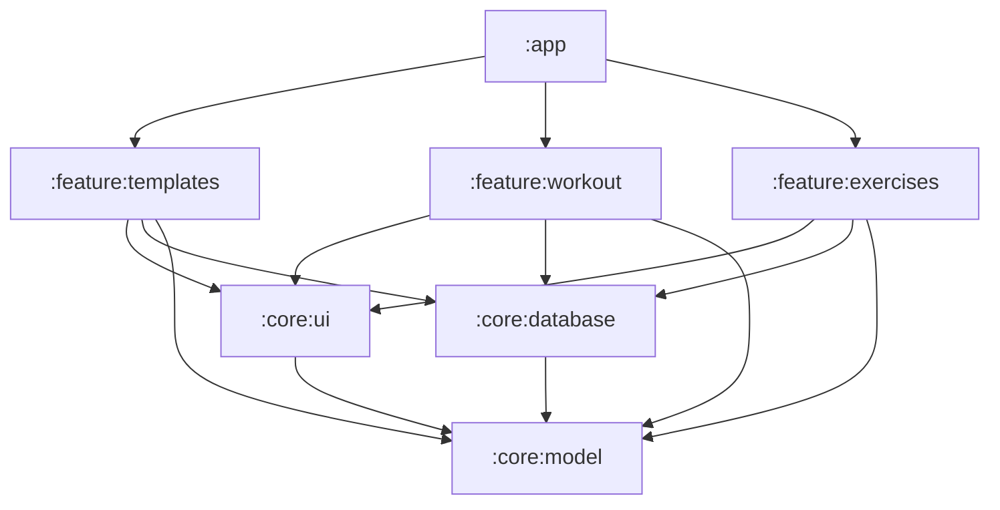

# ADR-002: Модульная архитектура проекта и скоуп MVP

> **Статус:** Принято (Accepted)  
> **Дата:** 2026-10-26  
> **Авторы:** Fullstack Android Engineer & System Analyst  

---

## 1. Контекст и решения по результатам Product Discovery
1. **Модель входа:** **Guest-First (Offline-First)**.
   - Пользователь сразу получает рабочий инструмент без регистрации.
   - Все данные хранятся локально в Room DB на устройстве.
   - При удалении или смене устройства в будущем будет предложен экспорт/импорт и облачная синхронизация.
2. **Критический скоуп MVP:**
   - **Конструктор шаблонов тренировок и сплитов** (День груди, День ног, Fullbody) с поддержкой **суперсетов**.
   - Каталог упражнений (предустановленные + кастомные) с группировкой по мышцам и инвентарю.
   - Модуль активного ведения тренировки (Live Workout Logging) со связью с шаблонами.

---

## 2. Структура модулей (Modular Architecture)

Для масштабируемости, быстроты компиляции и изоляции ответственности выбрана следующая модульная схема:

### Модули и ответственность:
- **`:core:model`** (Pure Kotlin): Доменные сущности без зависимостей от Android framework (`Exercise`, `WorkoutTemplate`, `WorkoutSet`, `Superset`).
- **`:core:database`** (Android Library): Room DB, Entities, DAOs, Database Migrations, Converters, Mappers в domain model.
- **`:core:ui`** (Android Library): Дизайн-система Jetpack Compose (Colors, Typography, Reusable Components: `SetRow`, `TimerIndicator`, `MuscleChip`).
- **`:feature:templates`** (Android Library): UI & ViewModels для создания, редактирования и организации шаблонов тренировок, объединения в суперсеты.
- **`:feature:exercises`** (Android Library): Каталог упражнений, фильтрация по группам мышц, создание кастомных упражнений.
- **`:feature:workout`** (Android Library): Экран ведения активной тренировки.
- **`:app`** (Android Application): Точка сборки, навигационный граф (Compose Navigation), DI граф (Koin).

---

## 3. Обоснование выбора системы управления зависимостями
Используется **Gradle Version Catalog (`gradle/libs.versions.toml`)**:
- Централизованное управление версиями зависимостей.
- Типобезопасные accessor'ы в `build.gradle.kts`.
- Соответствие современным стандартам Google Android Architecture Guides.
