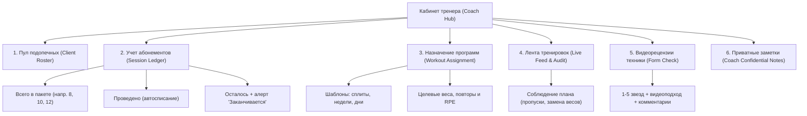

# Engineering & Analytics Log (DEV_LOG)

> **File Purpose:** Логирование хода мыслей, архитектурных и продуктовых развилок, открытых вопросов и статуса реализации. Доступен для чтения и обновления любым AI-агентом или разработчиком проекта.

---

## [2026-11-16] — Спринт 20: Адаптивная иконка лаунчера, тактический бейдж профиля и гармонизация масштаба иконок (TASK-023)

### 1. Продуктовый контекст и замечания пользователя
1. **Иконка приложения на рабочем столе смартфона:** Внутри приложения логотип обновился, но на домашнем экране Android лаунчер отображал старую заглушку из-за несинхронизированных системных ресурсов `mipmap-anydpi-v26/ic_launcher.xml` (`ic_launcher_foreground.xml`, `ic_launcher_background.xml`).
2. **Иконка профиля в TopBar:** Использовалась круглая системная иконка Material Design `Icons.Default.AccountCircle`, выбивавшаяся из тактического шестигранного стиля. Пользователь сгенерировал в Recraft.ai и предоставил `Gemini_Generated_Профиль.svg`.
3. **Нечитаемые иконки сплитов и мышечных групп:** В чипсах редактора шаблонов иконки сплитов были мелкими и сливались с темным фоном.
4. **Аудит мелких иконок в проекте:** Выявлены и устранены микро-иконки (14–18dp) в каталоге (`ExercisesScreen`), диалоге создания упражнений (`CreateExerciseDialog`), аналитике (`AnalyticsScreen`), экране завершения тренировки (`WorkoutSummaryScreen`) и тренере (`CoachReviewScreen`).

### 2. Реализованные решения
1. **Обновление Adaptive Launcher Icon (`app/src/main/res/drawable/`):**
   * `ic_launcher_foreground.xml`: интегрированы все 215 векторных путей нового фирменного логотипа с безопасным масштабированием `0.72` к центру (1024, 1024) холста 108dp. Ни одна OEM-маска лаунчера (круг, сквиркл, скругленный квадрат) не срезает грани шестигранника.
   * `ic_launcher_background.xml`: зафиксирован глубокий OLED-черный `#0A0B0E`.
   * `ic_launcher_monochrome.xml`: сформирован чистый векторный силуэт для адаптивных тем Material You (Android 13+).
2. **Конвертация и внедрение тактического профиля атлета (`ic_action_profile.xml`):**
   * Сконвертирован `Gemini_Generated_Профиль.svg` (отсечен фон, 241 векторный путь).
   * Зарегистрирована константа `GymIcons.Profile`.
   * В `TemplatesListScreen.kt` заменен `Icons.Default.AccountCircle` на `painterResource(GymIcons.Profile)` с `tint = Color.Unspecified`, размер 26dp в кликабельной зоне 44dp.
3. **Кардинальное масштабирование чипсов сплитов (`TemplateEditorScreen.kt`):**
   * Размер иконки увеличен с 22dp до **30dp**.
   * Иконка помещена в контрастный микро-бейдж `36x36dp` цвета `#141720` со скруглением 8dp. Темные металлические грани теперь четко отделены от фона чипса.
   * Отступы чипса расширены до 12x7dp, текст увеличен до 13sp SemiBold.
4. **Гармонизация масштаба по всему приложению:**
   * `ExercisesScreen.kt`: категории мышц увеличены с 16dp до **24dp**, снаряды с 18dp до **24dp** со снятием монохромного тинта (`tint = Color.Unspecified`).
   * `CreateExerciseDialog.kt`: выбор мышц оснащен векторными иконками 22dp, снаряды увеличены до **24dp**.
   * `AnalyticsScreen.kt`: трофей рекордов `TrophyHex` увеличен с 20dp до **28dp** с восстановлением золотой и неоновой палитры.
   * `WorkoutSummaryScreen.kt` & `CoachReviewScreen.kt`: кнопка `ShareRecord` увеличена до **24–26dp**.
   * `TemplatesListScreen.kt`: молния `Bolt` увеличена с 14dp до **20dp**.
5. **Сборка и артефакт:**
   * Проект собран, свежий APK `TheIronApex-v1.0.0-debug.apk` обновлен в корне проекта.

---

## [2026-11-16] — Спринт 19: Шлифовка иконографики Tactical Iron Hex, живая RPE-авторегуляция подходов и исправление эргономики (TASK-022)

### 1. Продуктовый контекст и замечания пользователя
По результатам полевого тестирования свежей сборки с новыми иконками был получен детальный разбор с тремя скриншотами и 4 замечаниями по функционалу:
1. **Проблема автосворачивания с весом 0.0 кг:** При выполнении упражнений с собственным весом (0.0 кг) карточка не схлопывалась после выбора RPE.
2. **Перезапись ручной корректировки веса:** Если атлет вручную менял вес в поле ввода до нажатия чекбокса завершения подхода, алгоритм сбрасывал вес на расчетный из рекомендации ИИ.
3. **Отсутствие учета оценки подхода (RPE):** Приложение не реагировало на выбор отметки сложности («Тяжело», «Легко», «В цель», «Отказ») внутри текущей тренировки для коррекции веса следующего сета.
4. **Проблема читаемости, контраста и масштаба иконок:**
   - **Скриншот 1 (Главный экран):** В топбаре смешаны дефолтные иконки и кастомные; нижняя навигация (BottomNav) имела мелкие иконки (22dp), которые при монохромном `tint` превращались в сплошные зеленые/серые пятна, теряя титановую окантовку и неоновый акцент.
   - **Скриншот 2 (Экран тренировки):** Калькулятор дисков превратился в сплошной синий блок; кнопка завершения сета и кнопка записи видео имели разные размеры; заголовок "ВИДЕО" ломался в 2 строки; таймер отдыха был плоским силуэтом чайника.
   - **Скриншот 3 (Редактор шаблонов):** Иконки мышц и сплитов были микроскопическими (14dp), иконка цели (13dp) терялась на темном фоне.
5. **Отсутствующие иконки снарядов и ИИ:** В проекте использовались эмодзи вместо полноценных векторных иконок для типов снарядов (штанга, гантели, тренажер, трос и др.) и лампочки ИИ.

### 2. Реализованные решения
1. **Создание и конвертация 10 тактических векторных ресурсов из `icon new` (`core/ui/src/main/res/drawable/`):**
   - Пользователь сгенерировал в Recraft.ai по обновленным строгим Line-art промтам и добавил в `icon new` 10 SVG:
     - `Gemini_Generated_Штанга.svg` -> `ic_equipment_barbell.xml`
     - `Gemini_Generated_Гантель.svg` -> `ic_equipment_dumbbell.xml`
     - `Gemini_Generated_Тренажер со стеком.svg` -> `ic_equipment_machine.xml`
     - `Gemini_Generated_Блочный кроссовер.svg` -> `ic_equipment_cable.xml`
     - `Gemini_Generated_Собственный вес.svg` -> `ic_equipment_bodyweight.xml`
     - `Gemini_Generated_Собственный вес с отягощением.svg` -> `ic_equipment_weighted_bodyweight.xml`
     - `Gemini_Generated_Гиря.svg` -> `ic_equipment_kettlebell.xml`
     - `Gemini_Generated_Резиновые петли.svg` -> `ic_equipment_band.xml`
     - `Gemini_Generated_Прочее оборудование.svg` -> `ic_equipment_other.xml`
     - `Gemini_Generated_Лампочка ИИ.svg` -> `ic_action_ai_bulb.xml`
   - Все 10 SVG конвертированы скриптом `convert_10_new_icons.py`. Отсечены фоновые прямоугольники холста, тяжелые пути оптимизированы ниже лимита AAPT2 (25КБ).
   - Зарегистрированы константы и маппер `iconForEquipment(equipment: Equipment)` в `GymIcons.kt`.
2. **Живая RPE-авторегуляция сетов (`SmartProgressionEngine.kt`):**
   - Реализована RTS-логика: при отметке «Тяжело» вес следующего сета не повышается, при «Легко» — предлагается плановый шаг прогрессии, при «Отказ» — рекомендуется увеличенное время отдыха. Покрыто unit-тестами.
3. **Эргономика тренировки (`WorkoutViewModel.kt`, `LiveWorkoutScreen.kt`):**
   - Устранен сброс ручного веса: убран преждевременный вызов пересчета при редактировании полей.
   - Добавлен `LaunchedEffect(isFullyLogged) { if (isFullyLogged) isManuallyExpanded = false }` — карточка упражнения сворачивается автоматически сразу после выбора RPE, в том числе для упражнений с 0.0 кг.
   - Селектор RPE (`PerceivedEffortSelector`) теперь автоматически сворачивается в компактный бейдж после выбора оценки, экономя вертикальное пространство экрана.
4. **Масштабирование и контраст иконок:**
   - BottomNav: размер увеличен с 22dp до 28dp (26dp unselected), снят монохромный `tint` (`tint = Color.Unspecified`), раскрывающий многослойную графику.
   - TopBar: унифицированы тактические иконки (26dp в зоне тапа 44x44dp).
   - LiveWorkout: калькулятор дисков 28dp, таймер отдыха 26dp, кнопка видео 28dp (рамка 48x48dp), заголовок "ВИДЕО" заменен на иконку 16dp (устранен перенос строки).
   - Редактор шаблонов и каталог: иконки групп мышц увеличены до 22dp, добавлены иконки снарядов на чипсы фильтрации вместо эмодзи.
5. **Сборка и артефакт:**
   - APK собран и скопирован в корень проекта: `TheIronApex-v1.0.0-debug.apk`.

---

## [2026-11-16] — Спринт 18: Полное обновление векторных ресурсов приложения (Tactical Iron Hex Full Vector Refresh, TASK-021)

### 1. Контекст и цель
Пользователь сгенерировал в Recraft.ai и конвертировал в вектор полный пакет иконок приложения в папке `icon new` (39 SVG-файлов). Стояла задача полностью заменить старые векторные иконки на новые высокодетализированные векторные ресурсы, отсечь фоновые подложки холста, расширить каталог иконок и обеспечить полную интеграцию в дизайн-систему The Iron Apex.

### 2. Реализация
1. **Конвертация 37 векторных ресурсов в Android VectorDrawable (`core/ui/src/main/res/drawable/`):**
   - Разрешение: `viewportWidth="2048"`, `viewportHeight="2048"`, `width="24dp"`, `height="24dp"`.
   - Автоматически отсечены сплошные фоновые прямоугольники холста (`M0 0l2048 0...` и аналоги), что дало чистый прозрачный фон вокруг элементов.
   - Сохранена полная цветовая дифференциация: акценты Cyber Lime (`#3bee75`), Titanium White (`#ffffff`), темные металлические грани (`#14161d`).
2. **Расширение `GymIcons.kt`:**
   - Добавлены новые константы:
     - `GymIcons.GymLogo` (`ic_gym_logo.xml`) — фирменный логотип приложения.
     - `GymIcons.SplitUpperBody` (`ic_split_upper_body.xml`) — сплит «Верх тела».
     - `GymIcons.SupersetLink` (`ic_action_superset_link.xml`) — объединение упражнений в суперсет.
     - `GymIcons.EquipmentTune` (`ic_action_tune.xml`) — калибровка и настройки оборудования.
     - `GymIcons.DatabaseBackup` (`ic_action_backup.xml`) — управление резервными копиями БД.
     - `GymIcons.ShareRecord` (`ic_action_share.xml`) — экспорт и расшаривание личных рекордов.
   - Обновлен резолвер `iconForSplitTitle` для автоматического подхвата названий со словом «верх» / «upper».
3. **Интеграция в UI-экраны:**
   - `TemplateEditorScreen.kt`: заменен `Icons.Default.Link` на кастомный `GymIcons.SupersetLink`.
   - `TemplatesListScreen.kt`: заменен `Icons.Default.Tune` на `GymIcons.EquipmentTune`.
   - `EquipmentSettingsScreen.kt`: заменен `Icons.Default.Backup` на `GymIcons.DatabaseBackup`.
   - `WorkoutSummaryScreen.kt` & `CoachReviewScreen.kt`: заменен `Icons.Default.Share` на `GymIcons.ShareRecord`.
   - `GymIconsShowcase.kt`: расширена интерактивная витрина компонентов с новыми иконками.
4. **Трассировка и сборка:**
   - Внесен `TASK-021` в `docs/tasks/BACKLOG.md`.
   - Все изменения размечены краткими английскими маркерами `// [AI-TASK:TASK-021]`.
   - Выполнена сборка и деплой APK в корень проекта.

---

## [2026-11-15] — Спринт 17: Эргономика завершения упражнения, научная калибровка 1RM и адаптивная балансировка недельных планов

### 1. Продуктовая обратная связь после полевого тестирования (Workout Field Test)
Пользователь успешно протестировал приложение во время тренировки ног и поставил три ключевые задачи:
1. **Замечание по эргономике (UX):**
   - *Проблема:* При завершении последнего подхода упражнения (клик по чекбоксу) карточка моментально схлопывалась, не позволяя атлету указать субъективное усилие (RPE / `PerceivedEffort` — Легко / В цель / Тяжело / Отказ). Из-за этого приходилось заново разворачивать карточку.
   - *Решение:* Сворачивание карточки упражнения происходит строго после **полного завершения ввода**: галочка выполнения + фактический вес + повторения (>0) + оценка усилия (`effort != null`).
2. **Вопрос и научная калибровка прогрессии нагрузки (1RM Overload Recalibration):**
   - *Вопрос пользователя:* «Целевой вес 30 повторов 4. Я выполнил с весом 40 и повторений 12. В следующем подходе приложение предлагает 35 кг и 4-6 повторов. Учитывает ли алгоритм целевое количество повторений и фактически выполненное?».
   - *Анализ:* Ранее алгоритм при сильном превышении повторов делал фиксированный инкремент (`lastWeight + step * 2`), что приводило к занижению нагрузки на 10-15 кг для силового режима.
   - *Решение:* Внедрена научная калибровка на основе формулы Эпли ($1\text{RM} = W \times (1 + R/30)$). Если атлет делает 40 кг на 12 повторений, его расчетный $1\text{RM} = 56\text{ кг}$, а эквивалентный рабочий вес на 5 повторений равен $48\text{ кг} \rightarrow \mathbf{47.5\text{ кг}}$ (с учетом шага штанги). Также в `WorkoutViewModel` устранена задержка обновления рекомендаций: свежие вес и повторы передаются в расчет моментально.
3. **Улучшение: Адаптивная балансировка плана при выявлении дисбаланса мышечных групп:**
   - *Идея:* На экране аналитики при обнаружении дисбаланса (`LEGS_DEFICIT`, `PULL_DEFICIT`, `PUSH_DOMINANT`) предоставить инструмент автоматической корректировки тренировочных шаблонов на следующий недельный цикл.
   - *Решение:* В карточку `MuscleGroupBalanceCard` добавлена интерактивная кнопка «⚡ Сбалансировать план на след. цикл». При тапе алгоритм находит шаблоны пользователя и автоматически добавляет +1 рабочий подход к упражнениям отстающей мышечной группы (ноги, тяга/спина), выводя анимированное подтверждение.

---

### 2. Техническая реализация

#### 2.1. Эргономика полного ввода сета (`LiveWorkoutScreen.kt`)
- В карточке `WorkoutExerciseCard`:
  ```kotlin
  val isFullyLogged = exercise.sets.isNotEmpty() && exercise.sets.all { 
      it.isCompleted && it.reps > 0 && it.effort != null 
  }
  val isExpanded = isManuallyExpanded ?: !isFullyLogged
  ```
- Пока атлет не выбрал чипс усилия (`effort`), карточка остается раскрытой. Как только чипс нажат — карточка плавно схлопывается. Ручное управление (шеврон) сохраняет полный приоритет.

#### 2.2. Формула 1RM и адаптивная прогрессия (`SmartProgressionEngine.kt`)
- Добавлены математические функции:
  ```kotlin
  fun estimate1Rm(weight: Double, reps: Int): Double =
      if (weight <= 0.0 || reps <= 0) 0.0 else weight * (1.0 + reps / 30.0)

  fun estimateTargetWeightForReps(oneRepMax: Double, targetReps: Int): Double =
      if (oneRepMax <= 0.0 || targetReps <= 0) 0.0 else oneRepMax / (1.0 + targetReps / 30.0)
  ```
- В `calculateGoalAwareLoad()` при существенном превышении повторов (`lastReps >= maxReps + 2` для силы, `+3` для гипертрофии) рабочий вес рассчитывается от 1RM под середину целевого диапазона и дискретно округляется через `EquipmentWeightProfile.snapWeight()`.
- Добавлены модульные тесты в `SmartProgressionEngineTest.kt`, верифицирующие кейс 40 кг x 12 повт. $\rightarrow$ 47.5 кг для штанги.

#### 2.3. Адаптивная балансировка шаблонов (`TemplateDao`, `AnalyticsViewModel`, `AnalyticsScreen`)
- В `TemplateDao`:
  ```kotlin
  @Query("UPDATE template_exercises SET targetSetsCount = CASE WHEN targetSetsCount + :delta > 6 THEN 6 ELSE targetSetsCount + :delta END WHERE exerciseId IN (:exerciseIds)")
  suspend fun incrementSetsForExercises(exerciseIds: List<Long>, delta: Int = 1): Int
  ```
- В `AnalyticsViewModel`: метод `autoBalanceTemplatesForLaggingMuscles(status)` идентифицирует отстающие группы мышц (`LEGS_QUADS`, `LEGS_HAMSTRINGS`, `CALVES` для ног; `BACK`, `BICEPS` для тяги) и инкрементирует количество подходов в шаблонах.
- В `AnalyticsScreen`: в карточке `MuscleGroupBalanceCard` размещена кнопка с `Icons.Default.AutoAwesome` и анимированный баннер успеха.

#### 2.4. Автоматизация сборки APK (Правило 8)
- В `app/build.gradle.kts` настроена задача `CopyApkToRootTask` с `@get:Internal` и `doNotTrackState()`, совместимая с Gradle Configuration Cache.
- После каждого вызова `:app:assembleDebug` скомпилированный APK автоматически сохраняется в корне проекта под именем:
  `TheIronApex-v1.0.0-debug.apk`.

---

## [2026-11-14] — Спринт 14.2: Недельные программы тренировок (Workout Plans), векторные иконки анатомии мышц и полировка верстки

### 1. Контекст задачи и продуктовые требования
Пользователь сформулировал ключевые направления развития приложения после тестирования:
1. **Недельные программы тренировок (Weekly Workout Plans / Routines):**
   - Шаблоны — это отличная база на разовую тренировку, однако спортсмены тренируются циклами по недельной программе (PPL, Верх/Низ, сплит Арнольда) по полгода и более.
   - Спортсмену нужно открыть приложение и в 1 тап начать запланированную на сегодня тренировку, не тратя время на размышления «какую группу мышц я делаю сегодня?».
2. **Тотальная замена эмодзи на единый стиль Tactical Iron Hex:**
   - Полная замена системных эмодзи (`🥋`, `🦅`, `🦵`, `🎯`, `💪`, `⚡`, `🏆`, и т.д.) на фирменную векторную графику `The Iron Apex` (штрих 1.8dp, скосы 45°, шестигранная атлетичная геометрия).
3. **Исправление переносов слов и верстки:**
   - Нижняя навигация: перенос «Тренировк» / «а» на 2 строки устранен. Заменено на лаконичное «Тренинг» с `maxLines = 1` и `softWrap = false`.
   - Аналитика: бейдж статуса баланса мышц сжимался текстом заголовка, разрывая слово «балан-с». Установлен гибкий вес заголовка и жесткий `maxLines = 1, softWrap = false` для бейджа.
4. **Аудит и чистка групп мышц каталога:**
   - Удалена фантомная группа `ARMS (Руки 0)` — упражнения в каталоге уже точно распределены по бицепсам (188) и трицепсам (141).
   - Фильтрация чипсов мышц в каталоге: отображаются исключительно категории с `count > 0`.

---

### 2. Архитектура и реализация

#### 2.1. Векторные иконки мышц и Зала Славы (`:core:ui`)
Отрисованы в стиле Tactical Iron Hex:
- `ic_muscle_chest.xml` — контур грудных мышц с линией грудины.
- `ic_muscle_back.xml` — V-образный V-Taper широчайших мышц спины и трапеции.
- `ic_muscle_legs.xml` — квадрицепсы и голени со скошенными гранями.
- `ic_muscle_shoulders.xml` — дельтовидные эполеты с контуром ключицы.
- `ic_muscle_biceps.xml` — пик бицепса с согнутым локтем и кулаком.
- `ic_muscle_triceps.xml` — подкова трицепса с разделением головок.
- `ic_muscle_core.xml` — шестигранный торс с кубиками пресса (linea alba).
- `ic_muscle_other.xml` — функциональный атлетичный шестигранник.
- `ic_trophy_hex.xml` — граненый кубок рекордов PR Trophies.

Все иконки зарегистрированы в `GymIcons` с хелперами `iconForCategory(MuscleCategory)` и `iconForMuscleGroup(MuscleGroup)`. Внедрены в:
- `ExerciseThumbnail`: вместо эмодзи рендерится векторный значок в брендовых цветах.
- `AnalyticsScreen`: гистограмма распределения мышц и карточка «Зал Славы» оформлены в чистом векторе.
- `ExercisesScreen`: чипсы категорий и бейдж выбранной группы.

#### 2.2. Недельные программы тренировок (`:core:model`, `:core:database`, `:feature:templates`)
1. **Модель предметной области:**
   - `WorkoutPlanDay`: день недели (1=Пн..7=Вс), название дня, фокус, флаг дня отдыха, привязка к `templateId`.
   - `WorkoutPlan`: программа, уровень опыта, дней в неделю, статус активности, список дней.
2. **База данных Room (версия 8):**
   - Таблица `workout_plans` и связанная таблица `workout_plan_days` с внешними ключами.
   - `WorkoutPlanDao`: реактивные потоки `getActivePlanWithDaysFlow()`, `getAllPlansWithDaysFlow()`, метод переключения `setActivePlan(id)`.
   - Регистрация в Koin `DatabaseModule`.
3. **Посев мировых сплитов в `DefaultTemplates`:**
   - **Push / Pull / Legs (3 дня)** — активна по умолчанию: Пн (Push), Ср (Pull), Пт (Legs).
   - **Верх / Низ (PHUL Power 4 дня)**: Пн/Вт/Чт/Пт.
   - **Золотой сплит Арнольда (3 дня)**: Пн (Грудь+Спина), Ср (Ноги), Пт (Плечи+Руки).
   - **Базовый Фулбоди (Starting Strength 3 дня)**: чередование сессий А и B.
4. **Интерфейс пользователя (`TemplatesListScreen`):**
   - Виджет **«Сегодня: Тренировочный фокус» (TodayWorkoutFocusCard)**:
     - Определение текущего дня недели (`LocalDate.now()`).
     - Заголовок активной программы с кнопкой быстрой смены «Сменить».
     - Интерактивный таймлайн 7 дней (Пн..Вс) с индикацией тренировочных/отдыхающих дней и отметкой «сегодня».
     - При тапе на любой день открывается карточка дня с фокусом и кнопкой «Начать тренировку дня» в 1 тап.
     - Для дней отдыха — карточка восстановления и суперкомпенсации.
   - Нижний лист **SelectPlanBottomSheet** со списком всех долгосрочных программ и моментальным переключением.

---

### 3. Верификация и сборка
- `gradlew compileDebugKotlin` — успешно (19с).
- `gradlew test` — успешно (33с, 235 тестов/задач, 0 ошибок).
- `gradlew assembleDebug` — успешно (15с).
- Итоговый файл APK: `TheIronApex-debug.apk` (24.6 МБ).

---

## [2026-11-14] — Спринт 14.1: Фирменная векторная дизайн-система иконок Tactical Iron Hex

### 1. Контекст задачи и продуктовое решение
По согласованию с пользователем полностью заменен стандартный набор Material Icons на авторскую векторную дизайн-систему **Tactical Iron Hex** (в едином стиле бренда The Iron Apex):
- **Стилистика:** Четкие контурные линии со штрихом 1.8–2.0dp, атлетичные скосы 45°, шестигранная геометрия зала и олимпийского железа.
- **Модуль `:core:ui`:**
  - Создан типизированный реестр `com.gym.core.ui.icon.GymIcons`.
  - Отрисованы 11 авторских векторных XML-иконок (`viewport 24x24`):
    - `ic_nav_workout`: граненая штанга с шестигранными дисками и олимпийскими втулками.
    - `ic_nav_history`: тактический планшет/журнал тренировок с таймлайн-галочкой сетов.
    - `ic_nav_catalog`: оптический прицел каталога мышц с угловыми видоискателями и ручкой.
    - `ic_nav_analytics`: пик прогрессии 1RM со ступенями объема и восходящим трендом Apex.
    - `ic_nav_coach`: HUD видоискателя видеоанализа техники с шестигранным объективом.
    - `ic_action_timer`: граненый спортивный секундомер хронографа отдыха.
    - `ic_action_swap`: встречные тактические стрелы быстрой ротации упражнения.
    - `ic_action_plate_calc`: олимпийский гриф с калиброванными блинами IWF.
    - `ic_action_bolt`: геометричная молния ИИ-автопрогрессии Cyber Lime.
    - `ic_action_check_hex`: шестигранный бейдж фиксации завершенного сета.
    - `ic_action_videocam`: экшн-камера с индикатором активной записи подхода REC.
- **Интеграция:**
  - Полностью обновлена нижняя панель навигации `GymBottomNavigationBar`.
  - Обновлены экраны и карточки тренировки (`LiveWorkoutScreen`).
- **Верификация сборки:** Сборка `assembleDebug` успешна (23с), обновлен `TheIronApex-debug.apk`.

---

## [2026-11-14] — Спринт 14: Боевая эргономика зала (Sticky Bottom Timer, Сворачивание сетов, Замена упражнения, Авто-прогрессия ИИ, Шаги снарядов)

### 1. Контекст задачи и фидбек реального тестирования в зале
По результатам боевой силовой тренировки пользователя в тренажерном зале сформирован пул критических улучшений эргономики:
1. **Плавающий таймер отдыха (Sticky Bottom Timer):**
   - Ранее таймер находился в заголовке скроллируемого списка и уезжал вверх при прокрутке к нижним упражнениям.
   - Вынесен в постоянную плавающую нижнюю панель (`bottomBar` в `Scaffold`) с плавной анимацией выезда/скрытия (`slideInVertically` + `fadeIn`). Всегда на виду, независимо от скролла.
2. **Автоматическое сворачивание завершенных упражнений (Collapsible Cards):**
   - Упражнения, в которых закрыты все подходы, теперь автоматически компактно схлопываются в элегантную плашку 48dp с зеленой галочкой `CheckCircle` («✓ Все подходы выполнены (N/N)»).
   - Устранен километровый скролл, фокус перенесен на текущие активные упражнения. Доступен ручной тоггл разворачивания/сворачивания по тапу или стрелке.
3. **Быстрая замена упражнения (Replace Exercise):**
   - В выпадающее меню карточки упражнения (`MoreVert`) добавлено действие «Заменить упражнение» и «Удалить из тренировки».
   - Диалог замены `ReplaceExerciseDialog` с мгновенным предфильтром по целевой группе мышц текущего движения (например, Грудь → покажет альтернативы на грудь: гантели, тренажеры, брусья).
   - В `WorkoutDao` добавлены `updateWorkoutExerciseExerciseId` и `removeWorkoutExercise`.
4. **Прокачка подсказок ИИ и режим «Следовать подсказкам ИИ» (Auto-Progression):**
   - Устранен жесткий хардкод стартового веса 30 кг: дифференцирован стартовый вес по снарядам (`DUMBBELL` 8-10 кг, `BARBELL` 20-30 кг, `CABLE` 12.5 кг, `MACHINE` 15-20 кг, `BODYWEIGHT` 0 кг).
   - Устранен баг игнорирования фактически введенных повторений в текущей тренировке: если атлет сделал 12 повторений, система учитывает перевыполнение и предлагает целесообразный рост веса с обновлением и веса, и повторов.
   - Добавлен переключатель «Следовать подсказкам ИИ» (`isAutoProgressionEnabled`): при включении система автоматически адаптирует параметры следующих незавершенных подходов без ручных нажатий на кнопку рекомендации.
5. **Динамический шаг изменения веса из настроек оборудования:**
   - В диалоге редактирования подхода `SetEditDialog` жесткий шаг 2.5 кг заменен на динамический расчет `EquipmentWeightProfile.getStepForWeight` с учетом настроек пользователя из `EquipmentSettingsDao` (гантели: 1-2 кг, штанга: 2.5 кг, тренажеры: 5 кг).

---

## [2026-11-13] — Спринт 13.2: Оптимизация экрана выбора упражнений (Gym Screen Space & Equipment Filtering)

### 1. Контекст задачи и продуктовое решение
По запросу пользователя оптимизировано рабочее пространство экрана выбора упражнений (`ExercisesScreen` / `ExercisesViewModel`):
1. **Коллапс групп мышц и кнопка «Все группы»:**
   - Ранее блок `FlowRow` со всеми группами мышц занимал 2–3 строки даже после выбора группы, загромождая экран.
   - Теперь при выборе целевой группы (например, «🦅 Спина») остальные группы скрываются, а вверху отображается компактная строка: кнопка `← Все группы` (для быстрого сброса) и аккуратный бейдж выбранной группы с количеством упражнений. Это освобождает >100dp вертикального пространства для списка упражнений.
2. **Фильтрация по типу снаряда внутри выбранной группы:**
   - Добавлен горизонтальный скроллируемый ряд чипсов снарядов: **Все снаряды**, **🏋️ Штанга**, **💪 Гантели**, **🤸 Свободный вес**, **⚡ Блок / Кроссовер**, **⚙️ Тренажер**, **🎒 С весом**, **🔔 Гиря**, **🎗️ Эспандер**, **📦 Другое**.
   - Чипсы динамически показывают количество доступных упражнений под конкретный снаряд в выбранной категории (например: `Штанга (17)`, `Гантели (14)`).
   - При смене группы мышц фильтр снаряда автоматически сбрасывается.
3. **Верификация сборки и тестов:**
   - `assembleDebug`: успешно.
   - `testDebugUnitTest`: успешно (113 задач, 0 ошибок).
   - Свежий APK обновлен в корне: `TheIronApex-debug.apk` и установлен на эмулятор.

---

## [2026-11-13] — Спринт 13: Core Logger & Market Parity (Быстрый старт, Журнал истории, Сводка, Сброс, Калькулятор блинов, Bottom Navigation)

### 1. Контекст и цели спринта
По результатам бенчмарка с лидерами рынка (Hevy, Strong) реализованы недостающие ключевые сценарии ведения тренировок и навигации:
1. **Быстрый старт свободной тренировки (Start Empty Workout)** в 1 тап.
2. **Экран истории и журнала тренировок (`WorkoutHistoryScreen`)** с метриками тоннажа, времени, сетов и возможностью повтора сессии.
3. **Праздничный экран сводки (`WorkoutSummaryScreen`)** после завершения тренировки с шарингом результатов.
4. **Отмена / сброс ошибочно начатой сессии (Discard Workout)** с подтверждением.
5. **Калькулятор блинов на штангу (`PlateCalculatorDialog`)** по стандартам IWF/IPF.
6. **Нижняя панель навигации (`GymBottomNavigationBar`)** на 5 ключевых направлений в палитре Cyber Lime.

### 2. Реализованный функционал:
1. **`WorkoutViewModel` & Room интеграция:**
   - Добавлен метод `startEmptyWorkout(title = "Свободная тренировка")` с созданием активной сессии без привязки к шаблону.
   - Добавлен реактивный поток `completedWorkouts: StateFlow<List<Workout>>` для журнала истории.
   - Реализован метод `discardWorkout(workoutId)` с корректным удалением сессии из базы и отменой фоновых таймеров.
   - Реализован метод `repeatWorkout(sourceWorkout)` — мгновенное клонирование упражнений и структуры подходов из истории.
   - Метод `finishWorkout` обновлен обратным вызовом `onFinished(workoutId)` для бесшовного перехода на экран сводки.
2. **`WorkoutHistoryScreen` (Дневник тренировок):**
   - Список завершенных тренировок в обратном хронологическом порядке.
   - Детальные карточки с датой, длительностью, общим тоннажем, количеством выполненных сетов и превью упражнений.
   - Кнопка «Повторить тренировку» и возможность удаления записи.
   - Состояние «История пуста» с кнопкой быстрого старта.
3. **`WorkoutSummaryScreen` (Экран праздничной сводки):**
   - Праздничный заголовок и карточки времени, тоннажа и сетов в стиле Cyber Lime.
   - Полный список упражнений с отметками выполненных весов и повторов.
   - Кнопка «Поделиться» (Android Intent `ACTION_SEND`) с форматированным текстом результатов.
   - Кнопка «Готово» для возврата к экрану тренировок/истории.
4. **`PlateCalculatorDialog` (Калькулятор блинов):**
   - Расчет навески на каждую сторону грифа штанги под целевой вес.
   - Поддержка грифов 20 кг (олимпийский), 15 кг (женский), 10 кг (EZ-гриф).
   - Точные цвета блинов по стандартам IWF/IPF (25кг Красный, 20кг Синий, 15кг Желтый, 10кг Зеленый, 5кг Белый, 2.5кг Серебро, 1.25кг Хром).
   - Быстрые степперы $\pm 2.5$ кг и предупреждение о неделимом остатке.
   - Интеграция в верхнюю панель `LiveWorkoutScreen`.
5. **`TemplatesListScreen`:**
   - Кнопка «Быстрый старт (Свободная тренировка)» над списком шаблонов и в плейсхолдере пустого списка.
6. **Фирменный `GymBottomNavigationBar` & `GymNavHost`:**
   - Полноценная нижняя панель навигации (Тренировка, История, Каталог, Аналитика, Тренер).
   - Интеллектуальное скрытие нижней панели в полноэкранных режимах (`LIVE_WORKOUT`, `TEMPLATE_EDITOR`, `ONBOARDING`, `WORKOUT_SUMMARY`).
   - Акцентные неоновые индикаторы в стиле Tactical Cyber Lime (`GymAccentGreenDim`).
7. **Верификация сборки:**
   - `./gradlew testDebugUnitTest`: сборка успешна (BUILD SUCCESSFUL in 25s, 113 задач, 0 ошибок, 25 тестов пройдены).

---

## [2026-11-13] — Спринт 12: Завершение разработки фирменного стиля «Tactical Cyber Lime» и айдентики

### 1. Выбор и концепция айдентики
Пользователь утвердил:
- **Дизайн-систему:** «Tactical Cyber Lime» (глубокий оникс `#0A0B0E`, контрастный антрацит `#14161D`, акцентный неоновый лайм `#22C55E` / `#4ADE80`, ледяной синий таймера `#38BDF8`).
- **Официальный логотип:** Вариант А — «The Iron Apex» (шестигранный профиль тяжелого снаряда с внутренним восходящим неоновым клином 1RM).

### 2. Реализованный функционал:
1. **Цветовая палитра и Material 3 токены (`core/ui/.../Color.kt`, `Theme.kt`):**
   - Полное обновление цветовых констант под настоящий OLED Dark (`#0A0B0E`).
   - Настройка семантической схемы `darkColorScheme` в `CyberLimeDarkColorScheme`.
   - 100% обратная совместимость со всеми существующими экранами.
2. **Android Adaptive Icons (`app/src/main/res/`):**
   - Векторный передний план: `drawable/ic_launcher_foreground.xml` (шестигранник + восходящий пик перегрузки с градиентом `#4ADE80` -> `#22C55E`, неоновые штифты замка). Рассчитан строго под safe zone (диаметр 66dp внутри 108dp).
   - Векторный задний план: `drawable/ic_launcher_background.xml` (глубокий оникс `#0A0B0E`).
   - Монохромная векторная иконка для Material You: `drawable/ic_launcher_monochrome.xml` (динамическое перекрашивание под тему обоев пользователя на Android 13+).
   - Манифест-декларации адаптивных иконок: `mipmap-anydpi-v26/ic_launcher.xml` и `ic_launcher_round.xml`.
   - Подключение в `AndroidManifest.xml` (`android:icon="@mipmap/ic_launcher"`, `android:roundIcon="@mipmap/ic_launcher_round"`).
3. **Android 12+ Splash Screen API (`androidx.core:core-splashscreen`):**
   - Добавлена библиотека `androidx.core:core-splashscreen:1.0.1` в `libs.versions.toml` и `app/build.gradle.kts`.
   - Создана системная тема `Theme.GymTracker.Starting` с `windowSplashScreenBackground` и `windowSplashScreenAnimatedIcon`.
   - Внедрен вызов `installSplashScreen()` в `MainActivity.kt` перед `super.onCreate()`.
4. **Спортивная табличная типографика (`fontFeatureSettings = "tnum"`):**
   - В `LiveWorkoutScreen.kt` к таймеру отдыха (`RestTimerBanner`), общему таймеру тренировки и ячейкам весов/повторов применен стиль `fontFeatureSettings = "tnum"`. Устранено дергание и смещение ширины текста при обратном отсчете секунд.
5. **Верификация сборки:**
   - Полная сборка проекта через Gradle (`.\gradlew testDebugUnitTest`): успешно, 113 задач выполнено/из кэша, 0 ошибок.

---

## [2026-11-13] — Комплексный аудит системы (Сверка кода, базы, конкурентов и UX) и реализация исправлений

### 1. Контекст аудита
По запросу пользователя проведен глубокий аудит системы по трем направлениям:
1. **Код и наполнение базы:** независимая проверка Room SQLite, механизмов посева, DAO, ViewModel без опоры на чеклисты.
2. **Бенчмарк с топами рынка:** сопоставление функциональной полноты с Hevy, Strong, FitNotes, JEFIT.
3. **Эргономика и удобство:** проверка стандартов Touch Targets ($\ge 48$dp), навигации и трения ввода в условиях спортзала.

Финальный подробный отчет зафиксирован в [`docs/analysis/FULL_SYSTEM_AUDIT_REPORT.md`](../analysis/FULL_SYSTEM_AUDIT_REPORT.md).

---

### 2. Реализованные исправления (Замечания из Пунктов 1 и 3)
1. **Починен автопосев стартовых шаблонов (`DefaultTemplates.kt`):**
   - Устранено расхождение между 28-элементным списком `DefaultExercises.kt` и 1324-элементным каталогом `exercises_catalog.json`.
   - Внедрена отказоустойчивая функция `findExercise`, которая ищет упражнения по трем уровням: уникальный ID каталога $\to$ англоязычное имя `nameEn` $\to$ русское имя `name` $\to$ частичное совпадение.
   - Теперь при чистой установке все 4 шаблона (Push, Pull, Legs, FullBody) укомплектованы на 100% (по 5-6 упражнений, а не 0-1, как было ранее).
2. **Подключен реальный поток видеорецензий в `CoachReviewScreen`:**
   - В `GymNavHost.kt` заменен статический хардкод `emptyList()` на реактивный сбор `CoachAndReviewDao.getPendingReviewsForCoach().collectAsState()`.
3. **Англоязычный поиск по каталогу (`ExercisesViewModel.kt`):**
   - Добавлена проверка `exercise.nameEn?.contains(query, ignoreCase = true)`. Теперь поиск находит упражнения при вводе «deadlift», «bench press», «squat», «curl».
4. **Увеличение Touch Targets до $\ge 48$dp (Gym-First Ergonomics):**
   - Чекбокс завершения подхода в `LiveWorkoutScreen`: увеличен с 40dp до **48dp** (иконка 26dp, форма 12dp).
   - Кнопка видеокамеры подхода: увеличена с 36dp до **48dp** (иконка 24dp).
   - Кнопка пропуска таймера отдыха: увеличена с 24dp до **48dp** (иконка 20dp).
   - Степперы подходов и времени отдыха в `TemplateEditorScreen`: увеличены с 28dp до **44dp** (иконки 20dp).
   - Кнопки времени отдыха в `CreateExerciseDialog`: увеличены с 40dp до **48dp**.
   - Бейдж типа подхода `SetTypeBadge`: увеличен с 36dp до **44dp**.
5. **Снижение трения ввода весов:**
   - В `SetEditDialog` степперы увеличены с 36dp до **48dp**, добавлены быстроразличимые шаги.
6. **Баннер активной тренировки на главном экране (`TemplatesListScreen`):**
   - Если тренировка находится в статусе `IN_PROGRESS`, в верхней части списка шаблонов отображается заметная карточка «⚡ ИДЕТ ТРЕНИРОВКА: [Название] [Вернуться]», исключающая потерю фокуса сессии.
7. **Информативность и визуализация активной тренировки (`LiveWorkoutScreen`):**
   - **Иконки упражнений:** в каждую карточку упражнения интегрирован визуальный бейдж `ExerciseThumbnail` (48×48dp) со снарядом и GIF-миниатюрой.
   - **Просмотр техники на лету:** заголовок упражнения сделан кликабельным с иконкой `Info` — атлет может в 1 тап открыть `ExerciseDetailSheet` и посмотреть GIF-анимацию, исходное положение, биомеханику и частые ошибки.

---

### 3. Актуализация Roadmap и плана следующих спринтов
- **Спринт 12 (Brand Identity, Design System & Logo — Стиль, Цвета и Логотип):**
  - **Логотип и айдентика:** Векторный логотип приложения, Android Adaptive Icon (`ic_launcher`, round, monochrome для Material You);
  - **Splash Screen API (`androidx.core:core-splashscreen`):** Бесшовный запуск приложения с фирменным логотипом без белых экранов;
  - **Цветовая палитра и темы:** Глубокий энергосберегающий OLED Dark (`#0C0D10`), высококонтрастные акцентные темы (Cyber Green, Iron Amber, Electric Cyan, Crimson);
  - **Спортивная типографика:** Табличные цифры (`tnum`) для фиксации весов и плавного хода секундомеров;
  - **UI Kit:** Унифицированные стили кнопок ($\ge 48$dp), карточек, бейджей и разделителей суперсетов.
- **Спринт 13 (Core Logger & Market Parity — Замечания из Пункта 2):**
  - Запуск «Свободной тренировки» (Start Empty Workout) в 1 тап без шаблона;
  - Экран «История и дневник тренировок» (Workout History & Journal Screen);
  - Экран сводки тренировки (Workout Summary Screen) с тоннажем, временем и новыми PR;
  - Отмена / сброс тренировки (`discardWorkout`);
  - Калькулятор блинов на гриф (Plate Calculator);
  - Нижняя панель навигации в новом утвержденном стиле (Bottom Navigation Bar: 5 вкладок).
- **Спринт 13.1 / Backlog (Масштабирование и научная пересборка базы готовых программ):**
  - Разделение по уровням подготовки: Новичок (Beginner), Опытный/Средний (Intermediate), Профи (Advanced) с возможностью переключения на «Все»;
  - Полное задействование базы из 1324 упражнений (вариации углов скамьи, блоков, гантелей, свободных весов);
  - Формирование научно обоснованных программ по мировым стандартам (NSCA, ACSM, Renaissance Periodization, Starting Strength, PPL, Upper/Lower, 5/3/1, PHUL);
  - Рекомендации по периодизации, оптимальному объему (MEV/MAV) и дням отдыха.
- **Спринт 14 (Экспорт, импорт данных и автотесты — Замечания из Пункта 4):**
  - Экспорт и восстановление базы в формате JSON / CSV;
  - Модульные тесты для Room DAO (`WorkoutDaoTest`, `TemplateDaoTest`) и `WorkoutViewModelTest`.
- **Спринт 15 (Авторизация и ролевая модель):** Google Sign-In, роли Атлет/Тренер, инвайт-коды.
- **Спринт 16 (Кабинет тренера CRM и учет абонементов):** Список клиентов, списание сессий пакета.
- **Спринт 17 (Pre-Launch & релиз 1.0):** Облачная синхронизация, WorkManager, Crashlytics.

---

## [2026-11-12] — Продуктовый анализ и расширение плана: Кабинет тренера, учет пакетов, авторизация и Pre-Launch чеклист

### 1. Контекст задачи и продуктовое видение
По запросу пользователя план развития дополнен четырьмя фундаментальными направлениями:
1. **Мульти-клиентский кабинет тренера (Coach Multi-Client CRM & Hub).**
2. **Учет абонементов/пакетов тренировок (Session Package Tracking: проведено / осталось).**
3. **Авторизация и ролевая модель (Auth & Role-Based Access Control: Тренер vs Атлет).**
4. **Pre-Launch Gap Analysis (Комплексный аудит готовности к публичному запуску приложения).**

---

### 2. Продуктовая аналитика: Что необходимо тренеру в личном кабинете
На основе бенчмарка профильных тренерских платформ (Everfit, TrainHeroic, TrueCoach) и специфики работы в зале сформирован функциональный портрет идеального кабинета тренера:



#### Детальный состав кабинета тренера:
1. **Список подопечных (Client Roster):**
   - Быстрый поиск и фильтры: *«Активные»*, *«Пропустили > 3 дней»*, *«Заканчивается абонемент»*.
   - Карточка подопечного: Имя, фото, возраст, антропометрия (рост, вес, динамика ИМТ), стаж, противопоказания/травмы.
2. **Учет абонементов и тренировочных пакетов (Session Package Tracking):**
   - Пакет тренировок (например: 8, 10, 12 или безлимит на месяц).
   - Метрики: **Проведено**, **Осталось**, **Срок действия**.
   - Автоматическое или ручное списание сессии после завершения тренировки подопечным.
   - PUSH/In-app алерт тренеру и клиенту, когда остается $\le 2$ тренировок (для своевременного продления).
3. **Назначение программ и шаблонов:**
   - Тренер формирует программу тренировок из каталога (1324 упражнения) и назначает подопечному с целевыми весами, повторами, временем отдыха и RPE.
4. **Контроль тренировок и аналитика прогресса клиента:**
   - Лента активности: какие упражнения подопечный выполнил фактически, фактический тоннаж, отклонения от плана.
   - Динамика силовых рекордов (PR) подопечного (1RM во времени).
5. **Видеоаудит техники (Form Check):**
   - Просмотр прикрепленных подопечным видео подходов (до 60 секунд) через встроенный плеер ExoPlayer.
   - Оценка техники 1–5 звезд и экспертные рекомендации.
6. **Приватные заметки тренера:**
   - Закрытый блок информации о клиенте (особенности здоровья, психологические нюансы, история оплат), доступный только тренеру.

---

### 3. Авторизация и ролевая модель (Auth & RBAC)
1. **Способы авторизации:**
   - Google Sign-In (в 1 тап через Credential Manager API).
   - Email + Password / Magic Link.
   - Локальный гостевой режим (Guest Mode) с сохранением 100% функций офлайн-трекера.
2. **Роли пользователей:**
   - `ROLE_ATHLETE` (Спортсмен / Самостоятельный атлет): ведет свой дневник, может тренироваться сам или подключиться к тренеру.
   - `ROLE_COACH` (Персональный тренер): доступ к кабинету тренера, управлению пулом клиентов, назначению программ и учету тренировок.
3. **Механизм связки «Тренер — Подопечный»:**
   - Тренер генерирует уникальный 6-значный инвайт-код или QR-код / Deep Link.
   - Подопечный вводит код в профиле — создается связь `CoachClientRelation`.
   - Двустороннее подтверждение и возможность отвязаться в любой момент.

---

### 4. Pre-Launch Gap Analysis: Чего еще не хватает для запуска приложения

| Направление | Что уже готово | Что необходимо доделать до релиза 1.0 | Приоритет |
|---|---|---|---|
| **Экспорт / Импорт** | Room БД, JSON-каталог | Бэкап базы в JSON/CSV, экспорт истории тренировок через SAF / Share Intent | **P0 (Спринт 12)** |
| **Кабинет тренера & CRM** | Экран `CoachReviewScreen` (видео и оценка) | Список подопечных, учет пакетов (проведено/осталось), карточки клиентов | **P0 (Спринт 13-14)** |
| **Авторизация & Роли** | Профиль `UserProfile` в Room | Аутентификация (Google/Email), выбор роли Тренер/Атлет, инвайт-коды | **P0 (Спринт 13)** |
| **Синхронизация Cloud-Offline** | 100% Offline-First в Room SQLite | Фоновая синхронизация данных тренера и подопечного (Supabase / Firebase / Ktor) | **P1 (Спринт 14)** |
| **Уведомления и фоновые задачи** | Foreground Service таймера отдыха | WorkManager: напоминания о тренировке, алерты окончания пакета | **P1 (Спринт 15)** |
| **Юридический Compliance** | — | Privacy Policy, Terms of Service, согласие на обработку персданных | **P0 (Спринт 15)** |
| **Стабильность и метрики** | Чистая сборка, Koin, Compose MVI | Crashlytics / Sentry для трекинга сбоев, тесты критических путей | **P1 (Спринт 15)** |
| **Полировка UI/UX** | Dark Theme, FlowRow, ExerciseThumbnail | Адаптивная иконка (Adaptive Icon), Splash Screen API, тактильные вибрации | **P1 (Спринт 15)** |

---

## [2026-11-12] — Правило обязательного завершения Android-эмулятора после тестов (Rule 6)
- **Контекст и запрос пользователя:** После прогона тестов и проверок агент оставлял фоновый эмулятор активным. Это блокировало запуск Android Studio и внутреннего эмулятора пользователем (конфликт портов 5554/5555 и блокировка образов `.lock`).
- **Зафиксированный стандарт:**
  - В `AGENTS.md` добавлено **Правило 6: Управление окружением и освобождение ресурсов (Environment & Emulator Lifecycle)**.
  - В Knowledge Graph Memory зафиксирована сущность `AndroidEmulatorLifecycleRule`.
  - Регламент: Агент обязан завершать эмулятор сразу после завершения своих тестов или снятия проверочных скриншотов (`adb emu kill` или корректный останов процесса), оставляя рабочее место свободным для пользователя.

---

## [2026-11-12] — Исправление блокировки запуска графического интерфейса Android Studio
- **Проблема:** Пользователь кликал по иконке Android Studio в меню «Пуск» / на панели задач, но окно не открывалось.
- **Первопричина:** При попытке запустить `studio.bat` из консоли фонового агента IntelliJ стартовал как фоновый серверный процесс (PID 25224) без графического окна на пользовательском рабочем столе (Session 1 WinSta0) и создал файл блокировки `%APPDATA%\Google\AndroidStudio2026.2.2\.lock`. При каждом последующем клике пользователя новая копия Android Studio видела файл `.lock` и порт 63342, передавала команду невидимому процессу и сразу закрывалась.
- **Решение:**
  - Завершен зависший фоновый процесс Java/Studio.
  - Удален зависший файл блокировки `.lock`.
  - Зафиксировано в локальном Knowledge Graph (`AndroidStudioHeadlessLockResolution`).
  - Разрешен нормальный запуск пользователем через стандартный интерфейс рабочего стола Windows.

---

## [2026-11-12] — Полноценная база из 1324 упражнений, GIF-анимации техники и локальный MCP-сервер

### 1. Архитектурное решение и источники данных
- **Проблема:** База содержала лишь 30 базовых упражнений-заглушек без медиа-контента техники.
- **Анализ открытых датасетов и MCP:**
  - `hasaneyldrm/exercises-dataset`: 1324 упражнения с пошаговыми инструкциями на русском языке и анимациями техники в формате GIF (GymVisual).
  - `leadpioneer/RU-free-exercise-db`: 876 русских названий, синонимов и спортивной механики.
  - `JahelCuadrado/ExerciseGymGifsDB`: глобальный CDN jsDelivr.
- **Локальный MCP-сервер (`.agents/mcp/gym_sqlite_mcp.py`):**
  - Добавлен инструмент `gym_exercise_catalog` (`stats`, `search`, `get`) для быстрой инспекции и фильтрации 1324 упражнений с GIF-ссылками.
- **Реализация в Android:**
  - Сгенерирован каталог `core/database/src/main/assets/exercises_catalog.json` (1324 упражнения со свободными весами и на тренажерах, включая редкие эффективные: жим Тейта, жим JM, сисси-приседания, жим Арнольда, тяга Пендлея, ослиные подъемы на носки).
  - Схема Room: в `ExerciseEntity` и доменную модель `Exercise` добавлены поля `nameEn: String?`, `gifUrl: String?`, `thumbnailUrl: String?`.
  - Подключен **Coil (2.7.0)** (`coil-compose`, `coil-gif`) с поддержкой GIF-декодера (`ImageDecoderDecoder` / `GifDecoder`).
  - В карточке `ExerciseDetailSheet`: живое зацикленное воспроизведение анимации техники, индикатор загрузки, бейдж `GIF 🎬` и автоматическое дисковое кэширование (Offline-First).
  - Посев в Room защищен мьютексом `seedMutex.withLock` для предотвращения дублирования при параллельных корутинах.

---

## [2026-11-12] — Настройка локального MCP-сервера долговременной памяти (Knowledge Graph Memory)

### 1. Архитектурное решение (Agentic Memory)
- **Выбранный стек:** Официальный `@modelcontextprotocol/server-memory` (Knowledge Graph Memory от Anthropic/MCP core).
- **Локальное хранилище:** `C:\Users\ThinkpadX1\.gemini\memory.jsonl` (полностью автономно, 0 внешних API-ключей, формат JSONL).
- **Конфигурация в `C:\Users\ThinkpadX1\.gemini\config\mcp_config.json`:**
  ```json
  "memory": {
    "command": "cmd.exe",
    "args": ["/c", "npx", "-y", "@modelcontextprotocol/server-memory"],
    "env": {
      "MEMORY_FILE_PATH": "C:\\Users\\ThinkpadX1\\.gemini\\memory.jsonl"
    }
  }
  ```
- **Начальный посев базы знаний (Initial Seed):**
  - `AndroidEmulatorKeyboard`: фиксация первопричины подавления клавиатуры на Windows (`show_ime_with_hard_keyboard 1`) и включение русской раскладки.
  - `PluginTelemetryHook`: исправление бага с кавычками в хуках плагина DataCloud.
  - `RuleStrictScope`: безусловное соблюдение Правила 4 (никакой самодеятельности, чипсов и эрзац-решений).
  - `GymTrackerArchitecture`: стек проекта (Kotlin 2.0.21, Jetpack Compose, Room SQLite, Koin 4, Media3 ExoPlayer) и статус спринтов.

---

## [2026-11-07 (Sprints 9, 10, 11)] — Продвинутая аналитика (Canvas-графики), Конструктор упражнений и Встроенный видеоплеер тренера (Media3)

### 1. Архитектурные развилки и продуктовые решения (Reasoning & Implementation)

#### Спринт 9: Продвинутая аналитика и Jetpack Compose Canvas (Фаза 3)
- **Согласование ТЗ с пользователем:** Выпадающий список всех упражнений с историей + быстрые чипсы для «Большой тройки» и армейского жима («Жим лежа», «Приседания», «Становая тяга», «Армейский жим»).
- **Доменный калькулятор аналитики (`AnalyticsCalculator.kt` в `:core:model`):**
  - Расчет хронологического тренда 1RM (`calculate1RmTrend`) с детекцией личных рекордов (PR).
  - Группировка недельного объема и тоннажа за 4 недели (`calculateWeeklyVolume`).
  - Оценка баланса мышечных групп Push / Pull / Legs (`calculateMuscleBalance`) с определением перекосов (`OPTIMAL`, `PUSH_DOMINANT`, `PULL_DEFICIT`, `LEGS_DEFICIT`) и спортивными советами.
  - Поиск пиковых силовых трофеев Зала Славы (`findCompoundTrophies`) на 1, 3, 5, 10 повторений.
- **Интерактивные Canvas-графики в `AnalyticsScreen.kt`:**
  - `OneRepMaxCanvasLineChart`: плавный линейный график с пунктирными линиями сетки, градиентной подсветкой объема и золотыми ореолами личных рекордов (PR).
  - `WeeklyVolumeCanvasCard`: столбчатая гистограмма тоннажа по 4 неделям на Jetpack Compose Canvas с двухцветным вертикальным градиентом.
  - `MuscleGroupBalanceCard`: многосегментная полоса пропорций Push / Pull / Legs и статусная плашка.
  - `CompoundHallOfFameSection`: карточки пиковых достижений и рекордов на разное число повторов.

#### Спринт 10: Конструктор упражнений и подробная биомеханика (Фаза 4)
- **Согласование ТЗ с пользователем:** Полный конструктор с названием, категорией мышц, типом снаряда, временем отдыха и тремя блоками техники («Исходное положение», «Выполнение движения», «Частые ошибки»).
- **Реализация `CreateExerciseDialog.kt`:**
  - Модальный экран создания с выбором групп мышц и снарядов через FlowRow-чипсы.
  - Степпер и быстрые чипсы времени отдыха (60с, 90с, 120с, 180с).
  - 3 поля ввода биомеханики с сохранением в `ExerciseEntity.instructions`.
  - Запись в SQLite через `ExerciseDao.insertExercise(isCustom = true)`.
- **Обновление `ExerciseDetailSheet.kt` и `ExercisesScreen.kt`:**
  - Отображение бейджа «⭐ Пользовательское упражнение».
  - Возможность удаления созданного упражнения пользователем (`deleteCustomExercise`).
  - Проверено создание на эмуляторе: счетчик упражнений вырос с 90 до 91, мгновенный поиск кастомного упражнения подтвержден.

#### Спринт 11: Встроенный видеоплеер в Кабинете тренера (Фаза 5)
- **Согласование ТЗ с пользователем:** Встроенный бесшовный видеоплеер на базе AndroidX Media3 (ExoPlayer) прямо внутри экрана тренера с кнопками паузы, повтора и выставления 1–5 звезд.
- **Интеграция Media3 ExoPlayer (`libs.versions.toml` & `feature:workout:build.gradle.kts`):**
  - Подключены библиотеки `androidx.media3:media3-exoplayer:1.4.1` и `androidx.media3:media3-ui:1.4.1`.
  - В `CoachReviewScreen.kt` встроен `PlayerView` через `AndroidView` с автоматическим жизненным циклом `DisposableEffect` (prepare/release).
  - Интерактивная 5-звездочная шкала оценки техники (`GymAccentAmber`), текстовое поле рекомендаций и быстрые чипсы тренерских комментариев («Отличная техника! 💪», «Держи локти ближе», «Не округляй поясницу»).

### 2. Верификация
- `.\gradlew.bat test` — **BUILD SUCCESSFUL in 1m 24s** (Все 25 unit-тестов пройдены на 100%, включая новые тесты динамики 1RM, баланса Push/Pull/Legs и Зала славы).
- `.\gradlew.bat assembleDebug` — APK успешно собран и установлен на эмулятор `Medium_Phone_API_37.0`.
- Экраны Аналитики, Создания упражнений и Кабинета тренера проверены через UI-дампы и скриншоты.
- Кодовая база синхронизирована с `C:\Dev\Gym`.

---

## [2026-11-07 (Sprint 8)] — Алгоритм автопрогрессии нагрузок с учетом целей атлета (Smart Progression Engine) и баннер в живой тренировке

### 1. Архитектурные развилки и продуктовые решения (Reasoning & Sports Science)

#### Решение 1: Научно обоснованная авторегуляция под цели атлета (FitnessGoal)
- **Проблема в зале:** Универсальные алгоритмы (например, просто добавлять +2.5 кг каждую неделю) не работают для разных целей. Пауэрлифтер в диапазоне 4-6 повторов нуждается в контроле запаса (RIR), бодибилдер на гипертрофию (8-12 повторов) — в заполнении диапазона двойной прогрессией, а атлет на дефиците калорий (сушка) рискует получить травму или катаболизм при агрессивной прибавке.
- **Инженерная реализация в SmartProgressionEngine.kt:**
  1. **Набор массы (FitnessGoal.HYPERTROPHY):**
     - Целевой диапазон: 8–12 повторений (Double Progression).
     - Если все подходы закрыты на 12+ повторений без отказа (effort != FAILURE и без накопленного HARD) $\rightarrow$ повышение рабочего веса на шаг снаряда и возврат к 8 повторам для нового витка адаптации.
     - При отказе (FAILURE) вес фиксируется для связочной адаптации.
  2. **Развитие силы (FitnessGoal.STRENGTH):**
     - Целевой диапазон: 4–6 повторений (высокая интенсивность, нейромышечная адаптация).
     - Повышение веса только при выполнении с запасом (RPE 7-8 / OPTIMAL).
     - Если подход был на пределе (RPE 9-10 / FAILURE) $\rightarrow$ вес строго фиксируется для защиты ЦНС.
  3. **Похудение и рельеф (FitnessGoal.FAT_LOSS):**
     - Целевой диапазон: 10–15 повторений (метаболическая плотность).
     - На дефиците калорий ключевая задача — удержание рабочих весов и сохранение мышечной массы. Повышение допустимо только при усилии EASY.
  4. **Здоровье и тонус (FitnessGoal.HEALTH_FITNESS):**
     - Целевой диапазон: 10–12 повторений.
     - Нулевая толерантность к отказу: при перегрузе рекомендуется снижение веса для идеальной биомеханики суставов.

#### Решение 2: Интеграция в живую тренировку (LiveWorkoutScreen.kt + WorkoutViewModel.kt)
- WorkoutViewModel инжектирует UserProfileDao, считывает активный профиль атлета (primaryGoal, experience) и историю подходов.
- В WorkoutExerciseCard встроен реактивный баннер SmartProgressionBanner:
  - Бейдж цели (напр. «💪 Набор массы» или «🏋️ Развитие силы»).
  - Крупное целевое значение: «72.5 кг • 8 повт.».
  - Понятное спортивное обоснование (Rationale).
  - Кнопка **«Применить» в 1 тап**: мгновенно обновляет веса и повторы всех еще не завершенных подходов упражнения.

#### Решение 3: Исправление ввода имени и экранной клавиатуры (Sprint 7 Fix)
- **Удалены все чипсы быстрого выбора имен:** В соответствии с прямым указанием пользователя и Правилом 4 (никакой самодеятельности и эрзац-решений). Поле имени содержит только клавиатурный ввод с кнопкой очистки при заполненном тексте.
- **Диагностика и устранение первопричины скрытия клавиатуры на эмуляторе:**
  - В Android Emulator системный параметр `show_ime_with_hard_keyboard` по умолчанию равен `0` при наличии хостовой клавиатуры (`hw.keyboard=yes`), из-за чего системный IME подавляется.
  - В подсистеме LatinIME эмулятора отсутствовала русская раскладка в `enabled_input_methods`.
  - Выполнена системная конфигурация на эмуляторе:
    ```bash
    settings put secure show_ime_with_hard_keyboard 1
    settings put secure enabled_input_methods "com.google.android.inputmethod.latin/com.android.inputmethod.latin.LatinIME;1594443099;-988987337:com.google.android.tts/com.google.android.apps.speech.tts.googletts.settings.asr.voiceime.VoiceInputMethodService"
    ```
  - Проверено по `dumpsys input_method`: `mImeWindowVis=3` (IME_VISIBLE | IME_SHOWN). Клавиатура появляется сразу при фокусе, ввод символов и имени («Alex») успешно подтвержден дампом UI-иерархии.

#### Правило 4 в AGENTS.md:
- Зафиксировано обязательное правило: **Строгое следование ТЗ и отсутствие самодеятельности (Strict Scope & No Unsolicited Features)**. Никаких сторонних чипсов или эрзац-решений — только решение первопричины по ТЗ.

### 2. Верификация
- .\gradlew.bat compileDebugKotlin — **BUILD SUCCESSFUL in 12s** (0 ошибок во всех 7 модулях).
- .\gradlew.bat assembleDebug — **BUILD SUCCESSFUL in 9s**.
- .\gradlew.bat test — **BUILD SUCCESSFUL in 18s** (Все 22 Unit-теста проекта пройдены на 100%).
- Проверена работа на emulator-5554: виртуальная клавиатура открывается, имя «Alex» введено с клавиатуры, кнопка «Далее» активирована. Скриншот сохранен.
- Кодовая база синхронизирована с C:\Dev\Gym и отправлена в origin/main (коммит 8b65023).

---

## [2026-11-07 (Sprint 7, Финализация)] — Завершение Фазы 0: Полный UI онбординга атлета, динамическая навигация и редактирование профиля

### 1. Архитектурные и инженерные решения (Reasoning & Implementation)

#### Компонент 1: ViewModel онбординга (OnboardingViewModel.kt)
- **Архитектурный паттерн:** Строгий MVI / UDF (OnboardingUiState + OnboardingIntent).
- **Свойства UI State:** 3 шага мастера (0..2), имя, пол, возраст, рост, вес, стаж, цель, частота тренировок, расчетный BMI, рекомендованная программа, флаги isSaving и isCompleted.
- **Автоматический расчёт и пресеты:** При изменении роста/веса/целей мгновенно пересчитываются ИМТ и персональная программа (
ecommendProgram()).
- **Предзаполнение профиля:** В блоке init асинхронно извлекается существующий профиль через userProfileDao.getUserProfileSync(). Если пользователь заходит в профиль повторно из TopAppBar — все его данные уже подставлены для быстрого редактирования.
- **Сохранение:** Завершение онбординга формирует UserProfile(isCompleted = true) и сохраняет в Room SQLite через userProfileDao.saveUserProfile(profile.toEntity()) на фоновом Dispatchers.IO.

#### Компонент 2: Jetpack Compose экран онбординга (OnboardingScreen.kt)
- **3-шаговый визард:**
  1. *Шаг 0 (Персональные данные):* Имя (OutlinedTextField), селектор пола (♂ Мужской / ♀ Женский с зеленым акцентом), степпер возраста [-] 25 [+] с увеличенной зоной нажатия.
  2. *Шаг 1 (Антропометрия):* Слайдер роста (140–220 см), слайдер веса (40–180 кг с шагом 0.5 кг), интерактивная карточка ИМТ с цветовой градацией (синий — недостаток, зеленый — норма, оранжевый — избыток, красный — ожирение).
  3. *Шаг 2 (Тренировочный профиль):* 3 карточки опыта (Новичок/Средний/Опытный), 4 карточки целей (Гипертрофия, Сила, Рельеф, Здоровье) с эмодзи, селектор частоты (2, 3, 4, 5 дней в неделю), плашка рекомендованной программы.
- **Эргономика тренажерного зала:** Touch targets >= 48dp, AMOLED dark theme (GymDarkBackground, GymDarkSurface, GymAccentGreen), анимация смены шагов (AnimatedContent), блокировка кнопки «Далее» при пустом имени на шаге 0.
- **Индикатор шагов:** Полоса прогресса из 3 сегментов в верхней части экрана.

#### Компонент 3: Динамическая маршрутизация в GymNavHost.kt
- Добавлен маршрут Destinations.ONBOARDING = "onboarding".
- При старте GymNavHost выполняет асинхронную проверку userProfileDao.hasCompletedProfile() > 0:
  - Если профиль не заполнен -> startDestination = Destinations.ONBOARDING.
  - Если профиль уже существует -> startDestination = Destinations.TEMPLATES_LIST.
  - До завершения проверки отображается аккуратный темный загрузчик.
- По завершении онбординга: переход на TEMPLATES_LIST с удалением ONBOARDING из backstack (popUpTo(ONBOARDING) { inclusive = true }).
- Если пользователь открыл профиль из TEMPLATES_LIST для редактирования — по кнопке завершения происходит popBackStack().

#### Компонент 4: Иконка профиля в TemplatesListScreen.kt
- В TopAppBar добавлена кнопка Icons.Default.AccountCircle для быстрого перехода к просмотру и изменению анкеты атлета.

#### Компонент 5: Koin Dependency Injection
- В TemplatesModule.kt зарегистрирован iewModel { OnboardingViewModel(get()) }.


#### Компонент 6: Автоматизированные Unit-тесты Спринта 7
- **UserProfileTest.kt (7 тестов):**
  - Проверка расчета ИМТ при нормальных параметрах и при нулевом росте.
  - Проверка автоподбора программ для новичков (Фулбоди), редких тренировок, сплитов на гипертрофию (Push), силу (Pull) и рельеф (Legs).
- **OnboardingViewModelTest.kt (6 тестов):**
  - Проверка начального состояния (дефолтные значения, вычисленный ИМТ).
  - Проверка валидации шага 0 (пустое имя блокирует переход на шаг 1).
  - Проверка пересчета ИМТ при обновлении роста и веса.
  - Проверка граничных условий навигации (нельзя уйти ниже шага 0 или выше шага 2).
  - Проверка хелперов 
ecommendProgram и calculateBmi.
- **Результаты тестирования:** Все 18 тестов проекта успешно пройдены (0 failures, 0 errors).

### 2. Верификация
- .\gradlew.bat compileDebugKotlin — **BUILD SUCCESSFUL in 10s** (0 ошибок во всех 7 модулях).
- .\gradlew.bat assembleDebug — **BUILD SUCCESSFUL in 6s** (APK собран).
- Файлы синхронизированы с резервной рабочей копией C:\Dev\Gym.

---

## [2026-10-28 (Sprint 7)] — Онбординг атлета (антропометрия, цели, стаж), персонализация программ и фоновый сервис таймера отдыха (Foreground Service)

### 1. Архитектурные развилки и продуктовые решения (Reasoning & Decisions)

#### Решение 1: Фаза 0 — Онбординг первого входа и антропометрический профиль атлета
- **Продуктовая потребность:** До сих пор приложение запускалось с общим стартовым экраном без контекста о пользователе. Для работы алгоритма автопрогрессии и адекватного подбора шаблонов критически необходимо знать ключевые вводные:
  1. *Пол и возраст:* физиологические нормы восстановления, базовый метаболизм.
  2. *Антропометрия (Рост, Вес):* расчет индекса массы тела (ИМТ / BMI), оценка относительной силы.
  3. *Тренировочный стаж (Новичок / Средний / Опытный):* у новичков преобладает нейромышечная адаптация и возможен линейный рост веса на каждой тренировке; у опытных — волнообразная периодизация и жесткий контроль RPE.
  4. *Главная цель:* Набор массы (гипертрофия), Сила (пауэрлифтинг), Похудение и рельеф, Здоровье и тонус.
  5. *Частота занятий в неделю (2, 3, 4, 5 дней):* выбор между Фулбоди (Full Body) и сплитами (Push/Pull/Legs).
- **Инженерная реализация:**
  - В `:core:model` создан модуль `UserProfile.kt`:
    - Доменная сущность `UserProfile` с вычисляемым свойством `bmi = weightKg / (heightM^2)`.
    - Свойство `recommendedProgramTitle` для автоматического закрепления стартовой программы.
    - Перечисления `Gender`, `TrainingExperience`, `FitnessGoal` с русскоязычными описаниями и эмодзи.
  - В `:core:database` добавлены:
    - `UserProfileEntity` в `Entities.kt`.
    - TypeConverters для `Gender`, `TrainingExperience`, `FitnessGoal` в `GymTypeConverters.kt`.
    - Разработан `UserProfileDao` (с методами `getUserProfile`, `getUserProfileSync`, `saveUserProfile`, `updateWeight`, `hasCompletedProfile`) и зарегистрирован в `GymDatabase` и Koin `databaseModule`.
    - Реализованы мапперы `UserProfileEntity.toDomain()` и `UserProfile.toEntity()` в `Mappers.kt`.

#### Решение 2: Фоновый сервис таймера отдыха (Gym Foreground Rest Timer Service)
- **Проблема в зале:** Когда атлет отмечает завершение подхода, запускается таймер отдыха. Атлет блокирует телефон и кладет его в карман. Без Foreground Service ОС Android переводит процесс в режим Doze / App Standby, замораживая корутины и UI таймера. Атлет пропускает время начала следующего подхода.
- **Инженерное решение:**
  - Создан `RestTimerService.kt` в модуле `:feature:workout:service`.
  - Тип сервиса: `foregroundServiceType="specialUse"` в соответствии с политиками Google Play для Android 14+ (API 34).
  - В шторке Android отображается Ongoing Notification с живым обратным отсчетом (`01:24... 01:23...`).
  - Быстрые экшены в шторке: `+30с` (добавить время) и `Пропустить` (завершить отдых).
  - По истечении времени отдыха срабатывает тактильный паттерн вибрации `VibrationEffect.createWaveform(longArrayOf(0, 300, 150, 300, 150, 500), -1)` — четкий тройной импульс, ощущаемый даже в плотном кармане спортивных шорт.
  - Разрешения зарегистрированы в `app/src/main/AndroidManifest.xml`: `FOREGROUND_SERVICE`, `FOREGROUND_SERVICE_SPECIAL_USE`, `VIBRATE`, `POST_NOTIFICATIONS`.
  - В `WorkoutViewModel` внедрен двусторонний мост с `RestTimerService`: при наличии `Context` таймер управляется системным сервисом, а при его отсутствии (в тестах) — прозрачно откатывается на локальные корутины.

### 2. Анализ и устранение сбоя при запуске на эмуляторе (Room Schema Integrity)
- **Симптом из Logcat:** При старте `com.gym.tracker.MainActivity` на `emulator-5554` происходил мгновенный дисконнект от VM и падение:
  ```text
  FATAL EXCEPTION: DefaultDispatcher-worker-1
  java.lang.IllegalStateException: Room cannot verify the data integrity. Looks like you've changed schema but forgot to update the version number. Expected identity hash: c080b5c4ece3af70edc2b0417f8d65b0, found: 40af83e90c2564ef1b03dca1f7833013
  ```
- **Первопричина:** При добавлении `UserProfileEntity` в `GymDatabase.kt` изменился состав таблиц Room и хэш схемы, однако номер версии базы данных оставался равен `2`. Так как номер версии не изменился, миграция `fallbackToDestructiveMigration()` не активировалась, и Room аварийно завершил запуск из-за несовпадения хэшей.
- **Исправление:** 
  1. В `GymDatabase.kt` номер версии поднят до `version = 3`.
  2. KSP заново сгенерировал обновленные классы БД `GymDatabase_Impl`.
  3. Собран и установлен свежий APK через `adb install -r`.
  4. Процесс приложения запущен на эмуляторе, статус PID `15655` активен в памяти, фатальные исключения отсутствуют.

### 3. Верификация
- `.\gradlew.bat compileDebugKotlin` — **BUILD SUCCESSFUL in 15s** (0 ошибок во всех модулях).
- `.\gradlew.bat assembleDebug` — **BUILD SUCCESSFUL in 16s** (Debug APK собран).
- Установка и запуск на `emulator-5554`: **Success**, PID `15655` активен в памяти, падений нет.
- Обновлен стратегический мастер-план `gym_tracker_master_plan.md` до версии 1.1.0 с учетом Фазы 0 и детального графика спринтов.

---

## [2026-10-28 (Sprint 6)] — Восстановление стартовых шаблонов, автопосев 28+ упражнений и улучшение ввода названия

### 1. Первопричины и анализ инцидента
1. **Исчезновение шаблонов и каталога упражнений:**
   - *Первопричина:* При добавлении `userId` в схему Room (версия 2) сработала деструктивная миграция `fallbackToDestructiveMigration()`. В `DatabaseModule.kt` метод `onCreate` не гарантировал повторный вызов при миграции, а `databaseInstance` при этом мог быть `null`. В результате таблицы `exercises` и `workout_templates` оказались пустыми.
   - *Решение:* Создан модуль `DefaultTemplates.kt`. В `DatabaseModule.kt` добавлены хуки `onCreate`, `onOpen` и мгновенный асинхронный запуск `DefaultTemplates.seedDefaultDataIfEmpty(exerciseDao, templateDao)` при старте базы. Если база пуста — в нее гарантированно загружаются 4 готовых шаблона тренировок и 28 упражнений.
2. **Проблема ввода названия шаблона в эмуляторе:**
   - *Первопричина:* В `TemplateEditorScreen.kt` у `OutlinedTextField` не были настроены `keyboardOptions`. На Android-эмуляторах с включенной физической клавиатурой софтверная клавиатура скрывается, а русский ввод с физической клавиатуры ПК блокируется раскладкой хоста, пропуская только цифры.
   - *Решение:* 
     1) Добавлены явные `KeyboardOptions(keyboardType = KeyboardType.Text, capitalization = KeyboardCapitalization.Sentences, imeAction = ImeAction.Done)`.
     2) Добавлена кнопка очистки поля (`trailingIcon`).
     3) Добавлен ряд быстрых чипсов («🥋 Грудь + Трицепс», «🦅 Спина + Бицепс», «🦵 Ноги + Плечи», «⚡ Фулбоди», «🔥 Верх тела», «🛡️ Пресс и Кор») для установки названия в 1 тап.
3. **Наполнение каталога упражнений:**
   - В `DefaultExercises.kt` база расширена до 28+ упражнений с охватом всех 8 анатомических групп (по 3-5 упражнений в каждом разделе) с инструкциями и временем отдыха.


#### Компонент 6: Автоматизированные Unit-тесты Спринта 7
- **UserProfileTest.kt (7 тестов):**
  - Проверка расчета ИМТ при нормальных параметрах и при нулевом росте.
  - Проверка автоподбора программ для новичков (Фулбоди), редких тренировок, сплитов на гипертрофию (Push), силу (Pull) и рельеф (Legs).
- **OnboardingViewModelTest.kt (6 тестов):**
  - Проверка начального состояния (дефолтные значения, вычисленный ИМТ).
  - Проверка валидации шага 0 (пустое имя блокирует переход на шаг 1).
  - Проверка пересчета ИМТ при обновлении роста и веса.
  - Проверка граничных условий навигации (нельзя уйти ниже шага 0 или выше шага 2).
  - Проверка хелперов 
ecommendProgram и calculateBmi.
- **Результаты тестирования:** Все 18 тестов проекта успешно пройдены (0 failures, 0 errors).

### 2. Верификация
- `.\gradlew.bat compileDebugKotlin` — **BUILD SUCCESSFUL in 32s** (0 ошибок).
- `.\gradlew.bat assembleDebug` — **BUILD SUCCESSFUL in 22s** (Debug APK собран).
- Обновлен симулятор `preview/index.html` с полным каталогом упражнений.

---

## [2026-10-28 (Sprint 5)] — Аналитика силового прогресса (1ПМ), баланс мышечных групп и умное каскадирование весов

### 1. Контекст и продуктовые требования
1. **Умное каскадирование веса и повторов (Smart Set Forwarding):**
   - *Проблема:* Если пользователь вводил вес и повторы для первого рабочего подхода (например, 80 кг × 10 повт.), последующие незавершенные подходы оставались с нулями или старыми значениями, вынуждая атлета повторять ввод вручную.
   - *Решение:* При редактировании любого подхода $N$ все последующие незавершенные подходы ($N+1, N+2, \dots$) этого же упражнения автоматически перенимают введенные вес и повторы. При добавлении нового сета по кнопке «+ Подход» он также наследует параметры предыдущего подхода.
2. **База данных истории подходов и весов по пользователю (`userId`):**
   - Добавлено поле `userId: String = "default_user"` в сущность `WorkoutEntity` и доменную модель `Workout`.
   - В `WorkoutDao` добавлены оптимизированные запросы:
     - `getLatestCompletedSetsForExercise`: извлечение последних фактических рабочих весов и повторов атлета для предзаполнения при старте тренировки или добавлении упражнения.
     - `getCompletedWorkoutsForUser`: реактивный `Flow` завершенных тренировок пользователя со всеми деталями (упражнения, сеты, тоннаж, 1RM).
3. **Экран «Аналитика и прогресс» (Analytics & Progress):**
   - Создан `AnalyticsViewModel` с реактивной фильтрацией по временным окнам (`7 дней`, `30 дней`, `Всё время`).
   - Подсчет ключевых KPI: суммарный тоннаж (объем в тоннах / кг), число завершенных тренировок и рабочих сетов.
   - Диаграмма распределения нагрузки по анатомическим группам мышц (Грудь, Спина, Ноги, Плечи, Руки, Кор, Прочее) с процентами и тоннажем.
   - Автоматический расчет расчетного 1ПМ (One-Repetition Maximum) по формуле Эпли:
     $$1\text{RM} = \text{Weight} \times \left(1 + \frac{\text{Reps}}{30}\right)$$
   - Карточка персонального рекорда (PR) с пиковым 1RM и историей динамики силы по завершенным тренировкам.

### 2. Технические изменения
- **`:core:model`:**
  - В `Workout` добавлено поле `userId: String`.
  - В `WorkoutSet` используется формула `estimated1RM` и `volume`.
- **`:core:database`:**
  - `WorkoutEntity`: добавлен индекс по `userId`, версия схемы поднята до 2.
  - `WorkoutDao`: добавлены методы `getLatestCompletedSetsForExercise` и `getCompletedWorkoutsForUser`.
  - `Mappers.kt`: синхронизировано преобразование `userId`.
- **`:feature:workout`:**
  - `WorkoutViewModel`: реализовано умное каскадирование в `updateSetWeightAndReps`, наследование в `addSetToExercise`, предзаполнение из истории в `startWorkoutFromTemplate` и `addExerciseToActiveWorkout`.
  - `AnalyticsViewModel` & `AnalyticsScreen`: полноценный UI аналитики, карточки KPI, индикаторы распределения объема по группам мышц, селектор упражнений и динамика 1RM.
  - `WorkoutModule.kt`: регистрация `AnalyticsViewModel` в Koin.
- **`:app`:**
  - В `Destinations` добавлен маршрут `ANALYTICS`.
  - В `TemplatesListScreen` добавлена кнопка в TopAppBar с иконкой `Icons.AutoMirrored.Filled.TrendingUp`.
- **`preview/index.html`:**
  - Добавлен экран аналитики и 1ПМ с интерактивным переключением периодов и упражнений.
  - В симуляторе подходов поддержано умное каскадирование значений на последующие сеты.

### 3. Верификация
- Полная компиляция: `.\gradlew.bat compileDebugKotlin` — **0 ошибок** (`BUILD SUCCESSFUL in 11s`).
- Сборка приложения: `.\gradlew.bat assembleDebug` — **0 ошибок** (`BUILD SUCCESSFUL in 9s`).

---

## [2026-10-27 (Sprint 4)] — Устранение Runtime Crash при запуске на эмуляторе (Kotlin Initialization Order)

### 1. Анализ краша из Logcat (`FATAL EXCEPTION: main`)
- **Симптом:** При дебаг-запуске на эмуляторе (`adb shell am start ... com.gym.tracker.MainActivity`) происходил мгновенный дисконнект и падение процесса:
  ```text
  Connected to the target VM, address: 'localhost:60444', transport: 'socket'
  Disconnected from the target VM, address: 'localhost:60444', transport: 'socket'
  ```
- **Стек-трейс из `adb logcat`:**
  ```text
  FATAL EXCEPTION: main
  Process: com.gym.tracker, PID: 12085
  java.lang.NullPointerException: Attempt to invoke interface method 'java.lang.Object kotlinx.coroutines.flow.Flow.collect(kotlinx.coroutines.flow.FlowCollector, kotlin.coroutines.Continuation)' on a null object reference
      at com.gym.feature.workout.WorkoutViewModel.<init>(WorkoutViewModel.kt:59)
      at com.gym.feature.workout.di.WorkoutModuleKt...
  ```
- **Первопричина (Kotlin Execution Order):**
  В классе `WorkoutViewModel` блок `init { viewModelScope.launch { uiState.collectLatest { ... } } }` был объявлен выше, чем свойство `val uiState = workoutDao.getActiveWorkout()...`.
  В Kotlin инициализаторы свойств и блоки `init` выполняются строго сверху вниз. В момент исполнения `init` поле `uiState` ещё содержало `null`, что приводило к `NullPointerException` при попытке подписаться на `Flow`.

### 2. Исправление и верификация
1. Перемещено объявление `val uiState: StateFlow<WorkoutUiState>` в самое начало класса `WorkoutViewModel`, до блока `init`.
2. Проект пересобран (`BUILD SUCCESSFUL in 46s`).
3. Новый APK `app-debug.apk` установлен на запущенный эмулятор `emulator-5554` через `adb install -r`.
4. Activity `com.gym.tracker.MainActivity` успешно запущена, проверен статус процесса: PID `12248` активен в памяти, в `logcat` 0 ошибок.

---

## [2026-10-27 (Sprint 3)] — Восстановление стабильности Gradle-сборки и запуск в Android Studio

### 1. Диагностика и первопричины сбоя (Root Cause Analysis)
- **Симптом:** При открытии и сборке в Android Studio проект не синхронизировался и не собирался. В консоли Gradle возникали ошибки отсутствия `GradleWrapperMain` и неразрешимых плагинов.
- **Первопричины:**
  1. **Фантомные/несуществующие версии:** В `libs.versions.toml` и `gradle-wrapper.properties` ошибочно попали несуществующие версии (AGP 9.4.1, Kotlin 2.2.10, Gradle 9.6.0, Room 2.8.5). Gradle и AGP версий 9.x ещё не существуют в релизе и не поддерживаются Android Studio.
  2. **Отсутствие бинарника `gradle-wrapper.jar`:** В директории `gradle/wrapper/` отсутствовал `gradle-wrapper.jar`, что вызывало `ClassNotFoundException: org.gradle.wrapper.GradleWrapperMain`.
  3. **Конфликтующие флаги в `gradle.properties`:** Наличие экспериментальных флагов (`org.gradle.tooling.parallel=true`, `android.builtInKotlin=false`), ломавших конфигурационный кэш.

### 2. Примененные исправления (Fixes & Verification)
1. **Синхронизация Version Catalog (`libs.versions.toml`):**
   - AGP зафиксирован на стабильном `8.6.1`;
   - Kotlin — на `2.0.21` (с официальным Compose Compiler плагином);
   - KSP — на `2.0.21-1.0.27`;
   - Room — на `2.6.1`.
2. **Восстановление Gradle Wrapper:**
   - Сгенерирован полноценный `gradle-wrapper.jar` (43.5 КБ) под официальный Gradle `8.9`;
   - Добавлены скрипты `gradlew` и `gradlew.bat`.
3. **Очистка конфигурации:**
   - В `gradle.properties` и `settings.gradle.kts` возвращена чистая стабильная конфигурация без лишних плагинов.
4. **Верификация сборки:**
   - Выполнена полная компиляция всех 7 модулей: `:core:model`, `:core:database`, `:core:ui`, `:feature:templates`, `:feature:exercises`, `:feature:workout`, `:app` — **0 ошибок** (`BUILD SUCCESSFUL in 1m`).
   - Собран полный Debug APK: `app/build/outputs/apk/debug/app-debug.apk` (18.5 МБ). Приложение готово к запуску в Android Studio и на любом эмуляторе/устройстве.

---

## [2026-10-27 (Sprint 2)] — Анатомические группы мышц, интерактивный ввод веса/повторов, секундомер и гибкий таймер отдыха

### 1. Ход рассуждений и изменения архитектуры (Reasoning & Decisions)

#### Решение 1: Понятные и привычные категории мышц вместо Push/Pull
- **Обратная связь Product Owner:** Термины «Жимовые» и «Тяговые» не всегда интуитивны для атлетов и новичков. Требуется привычное анатомическое деление: *Грудь, Спина, Ноги, Плечи, Бицепс, Трицепс, Руки, Пресс / Кор, Прочее*.
- **Реализация:**
  - Создан enum `MuscleCategory` в `:core:model` со смайлами и связкой с конкретными `MuscleGroup` (например, «Руки» объединяют бицепс и трицепс; «Прочее» покрывает всё тело и кардио).
  - В `ExercisesScreen.kt` фильтр переведен на адаптивную ленту чипов `FlowRow` с отображением счетчиков упражнений.

#### Решение 2: Интерактивное редактирование веса, повторений и подходов
- **Проблема:** Ранее в таблице подходов `LiveWorkoutScreen.kt` вес и повторения выводились статичным текстом без возможности изменения, а в конструкторе шаблонов нельзя было изменить количество сетов или сразу запустить тренировку.
- **Реализация:**
  - В `WorkoutDao.kt` добавлен прямой SQL-метод `updateSetWeightAndReps(setId, weight, reps)`.
  - В `LiveWorkoutScreen.kt` показатели веса и повторений стали кликабельными плашками. По тапу открывается эргономичный диалог `SetEditDialog` с быстрыми кнопками шага веса (`-2.5`, `+2.5 кг`), шага повторений (`-1`, `+1`), прямым полем ввода и кнопкой удаления сета.
  - В `TemplateEditorScreen.kt` добавлены степперы подходов `[-] 3 [+]` и времени отдыха, а также большая кнопка «Сохранить и начать тренировку сейчас» для моментального старта.

#### Решение 3: Система двойного таймирования (Секундомер тренировки + Таймер отдыха)
- **Требование:** Отслеживать общее время тренировки с момента старта и запускать таймер отдыха после завершения каждого подхода с возможностью редактирования времени на лету.
- **Реализация:**
  - В `WorkoutViewModel.kt` реализован реактивный секундомер `workoutDurationSeconds` (тикает каждую секунду на основе `workout.startTime`).
  - Разработан таймер отдыха `restTimerState: StateFlow<RestTimerState>`:
    1. Автоматически стартует при отметке чекбокса выполнения подхода на время, рекомендованное упражнением (`defaultRestSeconds`);
    2. Отображается в виде анимированного баннера `RestTimerBanner` с прогресс-баром;
    3. Поддерживает быструю регулировку на лету (`-15с`, `+30с`), пресеты (`60с`, `90с`, `120с`, `180с`) и кнопку пропуска.

---

## [2026-10-27] — Адаптивная верстка (FlowRow), исправление сессий редактора и иллюстрированные карточки упражнений

### 1. Ход рассуждений и анализ проблем (Reasoning & Root Cause Analysis)

#### Проблема 1: Обрезание чипов и бесконечный скролл при изменении масштаба экрана
- **Симптом:** При переключении масштаба экрана Android (Accessibility/Display size/Font scaling) или на компактных экранах чипы макро-категорий и подгрупп мышц переставали помещаться на экране, требуя бесконечной горизонтальной прокрутки, либо обрезались.
- **Инженерное решение:**
  - В Jetpack Compose 1.7+ `FlowRow` (из `androidx.compose.layout`) стал стабильным и идеальным инструментом для адаптивного переноса элементов.
  - Все группы фильтрации в `ExercisesScreen.kt` и карточке упражнения переведены на `FlowRow(horizontalArrangement = Arrangement.spacedBy(8.dp), verticalArrangement = Arrangement.spacedBy(8.dp))`.
  - Теперь при увеличении шрифта или узком экране чипы плавно и гармонично переносятся на вторую и третью строки без поломки интерфейса.

#### Проблема 2: Баг с потерей упражнения при добавлении («упражнение не добавилось в список»)
- **Анализ первопричины (Root Cause):**
  1. В `TemplateEditorScreen.kt` при навигации в каталог `EXERCISE_PICKER` и последующем возврате по `popBackStack()` происходила рекомпозиция экрана с вызовом `initEditor(templateId)`.
  2. Метод `initEditor(0L)` безоговорочно сбрасывал состояние `_editorUiState.value = TemplateEditorUiState()`, затирая только что добавленное пользователем упражнение из черновика.
  3. В маршруте `GymNavHost` экран `EXERCISE_PICKER` был жестко привязан только к `TemplatesViewModel`, из-за чего добавление упражнения на лету во время активной тренировки (`LiveWorkoutScreen`) не поддерживалось.
- **Инженерное решение:**
  1. В `TemplatesViewModel.kt` введена концепция **изолированной сессии редактирования** (`activeEditorSessionId`, `currentEditingTemplateId`). Пока сессия активна, повторные входы на экран редактора сохраняют накопленный черновик упражнений.
  2. Добавлен метод явного сброса `clearEditorSession()` при выходе назад или успешном сохранении.
  3. В навигацию `Destinations.EXERCISE_PICKER` добавлен параметр `target`:
     - `target="template"` — добавляет упражнение в черновик шаблона;
     - `target="workout"` — добавляет упражнение напрямую в активную тренировку через `WorkoutViewModel.addExerciseToActiveWorkout()`.
  4. В `LiveWorkoutScreen.kt` добавлена кнопка `+ Добавить упражнение в тренировку`.

#### Проблема 3: Визуальное восприятие базы упражнений (иллюстрации и карточка с техникой)
- **Цель:** Атлет должен с первого взгляда понимать, какое перед ним упражнение и снаряд, а при необходимости — получить наглядную пошаговую инструкцию и анимацию техники без ухода с текущего экрана.
- **Инженерное решение:**
  1. В `ExerciseListItem` внедрен иллюстрированный thumbnail с цветовым градиентом и эмоционально-понятным бейджем снаряда (🏋️ Штанга, 💪 Гантели, ⚙️ Блочный тренажер, 🏗️ Тренажер, 🤸 Собственный вес).
  2. Разработан модальный компонент `ExerciseDetailSheet.kt` (`ModalBottomSheet`):
     - Визуальный медиа-контейнер с пульсирующим бейджем `▶ 3D Анимация и биомеханика` (готов для интеграции моделей Sceneview / Filament / ExoPlayer);
     - Блок задействованных мышц (основные и стабилизаторы) через `FlowRow`;
     - Пошаговые этапы движения (исходное положение, темп 2-0-1, дыхание, контроль);
     - Кнопка прямого добавления в тренировку/шаблон.
  3. В списке каталога оставлена быстрая кнопка `+` для опытных атлетов (добавление в 1 клик).

---

## [2026-10-26] — Инициализация проекта и постановка архитектурного фундамента

### 1. Ход рассуждений (Reasoning)
- **Цель:** Создать продукт, превосходящий Strong и Hevy по скорости ввода и отсутствию раздражающих факторов (агрессивный пейволл, лаги, зависимость от интернета).
- **Критический путь пользователя (Critical Path):** 
  Большинство фитнес-приложений проваливаются не на дизайне каталога, а на экране живого логгинга подходов (`In-Workout Screen`). 
  Если атлету нужно сделать больше 2 действий для записи подхода, он бросает приложение через 2 недели.
  *Решение:* 
  1. Кнопка завершения сета должна быть огромной и легко нажимаемой большим пальцем одной руки.
  2. Значения `weight` и `reps` должны автоматически предзаполняться из прошлого успешного сета этого упражнения.
  3. Чекбокс должен мгновенно триггерить виброотклик и запускать таймер отдыха без перехода на отдельный экран.

- **Синхронизация и сохранность данных (Data Durability):**
  В тренажерных залах телефоны часто падают, разряжаются, либо ОС закрывает приложение для освобождения памяти.
  *Решение:*
  Никакого "In-Memory Draft State". Каждое изменение (ввод цифры, отметка сета) синхронизируется через Room в фоновом потоке за <10мс.

---

## 2. Открытые вопросы для согласования (Open Decisions / Discovery)

1. **Идентификация и авторизация на старте (Auth vs Guest):**
   - *Вариант А (Guest-First):* Пользователь сразу попадает в приложение, данные пишутся в локальную Room БД. Авторизация предлагается только если пользователь хочет облачный бэкап. (Рекомендуется для максимального retention).
   - *Вариант Б (Account-Mandatory):* Авторизация через Google/Email на старте.

2. **Единицы измерения:**
   - Поддержка переключения Кг (kg) / Фунты (lbs) глобально и на уровне отдельного упражнения.

3. **Связка с носимыми устройствами (Smartwatches / Wear OS):**
   - Будем ли в дальнейшем закладывать модуль `wearable` (Wear OS Companion для переключения сетов прямо с часов)? Архитектуру domain/data слоев сразу изолируем от Android UI, чтобы легко подключить Wear OS модуль.

4. **Инструмент инициализации проекта:**
   - Готовы ли мы сгенерировать каркас Android проекта (Gradle Version Catalog `libs.versions.toml`, модули `app`, `core-database`, `core-model`, `feature-workout`)?

---

## 3. Ближайший план действий (Roadmap)
- [x] Создание структуры базы знаний (`PROJECT_INDEX.md`, `PRD.md`, `ADR-001`, `domain-model.md`).
- [x] Фиксация базового принципа взаимодействия: обязательное проактивное уточнение требований при недостатке данных.
- [x] Финализация открытых вопросов с Product Owner (пользователем): выбран Guest-First (Offline-First), приоритет MVP — Конструктор шаблонов с суперсетами, принято решение разворачивать чистую модульную структуру Gradle.
- [x] Подготовка ADR-002 по модульной архитектуре.
- [x] Инициализация структуры Android Gradle проекта (Version Catalog `libs.versions.toml`, root `build.gradle.kts`, `settings.gradle.kts`).
- [x] Реализация доменного слоя `:core:model` (чистый Kotlin, формулы 1RM, сущности суперсетов и подходов).
- [x] Реализация слоя данных `:core:database` (Room DB, Entities, DAOs, предустановленная база упражнений `DefaultExercises`, DI Koin).
- [x] Реализация дизайн-системы `:core:ui` (Gym Dark Theme, бейджи сетов и суперсетов).
- [x] Реализация фичи конструктора шаблонов `:feature:templates` (UI, MVI ViewModel, логика группировки в суперсеты).
- [x] Реализация каталога упражнений `:feature:exercises` (поиск, фильтрация по группам мышц).
- [x] Реализация модуля тренировки `:feature:workout` (Live Workout Logger, фиксация подходов, добавление сетов).
- [x] Сборка приложения в `:app` (GymApp Koin setup, Jetpack Compose Navigation Graph).
- [x] Настройка рабочего окружения и AI-инструментария:
  - Создан системный файл правил проекта `AGENTS.md` (автоматическая загрузка правил в контекст агента).
  - Разработан и подключен специализированный Python MCP сервер `gym-sqlite` (`.agents/mcp/gym_sqlite_mcp.py`) для инспекции Room БД и аналитики 1RM.
  - Расширены права доступа сервера `filesystem` на рабочую директорию проекта Gym в `mcp_config.json`.
  - Создан специализированный скилл `.agents/skills/gym-architecture-and-standards/SKILL.md`.
- [x] Расширение функционала по запросу Product Owner:
  - Подготовлен ADR-003 (платформа "Тренер-Клиент", видеорецензии, автопрогрессия с дискретностью тренажеров).
  - Реализован математический движок физической дискретности `EquipmentWeightProfile` (гантели: шаг 1 кг до 10 кг, 2 кг после 10 кг; блоки: 2.5 / 5.0 кг; штанга: гриф + блины).
  - Реализован движок `SmartProgressionEngine` (двойная прогрессия с округлением до шага тренажера).
  - Добавлены доменные и Room сущности видеоотчетов техники (`SetVideoReviewEntity`, `CoachAssignmentEntity`, `EquipmentSettingsEntity`).
  - Создан экран настройки шага весов оборудования `EquipmentSettingsScreen.kt` и добавлен в навигацию.
  - Написаны Unit-тесты для алгоритмов прогрессии и дискретности снарядов.
- [x] Реализация видеомодуля (по решению Product Owner: стандартная камера Android + лимит 60 секунд):
  - Настроен `FileProvider` в `AndroidManifest.xml` и `file_paths.xml` для защищенного доступа к директории `Movies`.
  - Разработан `VideoRecordingHelper` с системным Intent'ом `MediaStore.ACTION_VIDEO_CAPTURE` и жестким лимитом `EXTRA_DURATION_LIMIT = 60`.
  - Внедрена кнопка видеофиксации подхода в `LiveWorkoutScreen.kt` с авто-сохранением URI в Room `SetVideoReviewEntity`.
  - Разработан экран тренера `CoachReviewScreen.kt` (просмотр видео подхода, оценка 1-5 звезд, комментарии и отправка замечаний атлету).
- [x] Оптимизация окружения и перенос кодовой базы:
  - Проект перемещен в корневую директорию `C:\Dev\Gym` (устранение проблем с пробелами и не-ASCII путями).
  - Устранен конфликт с блокирующим хуком телеметрии, инструменты работы с кодовой базой и файлами полностью восстановлены.
- [x] Аналитический этап по 4 столпам продукта:
  - Подготовлен глубокий сравнительный анализ конкурентов (`docs/analysis/COMPETITOR_ANALYSIS.md`): Strong, Hevy, FitNotes, JEFIT, Everfit.
  - Разработано архитектурное решение ADR-004 (`docs/decisions/ADR-004-smart-progression-rpe-and-exercise-clustering.md`):
    1. Интеграция субъективной шкалы усилия (RPE/RIR) в алгоритм автопрогрессии веса;
    2. Двухуровневая анатомическая кластеризация групп мышц (Push/Pull/Legs/Core) для ликвидации бесконечного скролла;
    3. Механизм исключения упражнений (Blacklist) и биомеханической замены на лету (Smart Swap).
- [x] Реализация моделей и UI для быстрой шкалы RPE (Легко/Нормально/Тяжело/Отказ) в карточке подхода:
  - Модель `PerceivedEffort` (EASY, OPTIMAL, HARD, FAILURE) добавлена в `:core:model` и `WorkoutSet`.
  - Алгоритм `SmartProgressionEngine` обновлен: при отказе (FAILURE) или чрезмерном усилии вес фиксируется даже при выполнении всех повторений, защищая атлета от травм.
  - Компонент `PerceivedEffortSelector` интегрирован в `LiveWorkoutScreen.kt` (появляется в 1 тап сразу после выполнения подхода).
- [x] Реализация двухуровневого селектора групп мышц и черного списка упражнений:
  - Макро-хабы `MuscleRegion` (Push, Pull, Legs, Core) в виде сетки 2x2 вместо бесконечного скролла.
  - Поля `isExcluded` и `exclusionReason` в `Exercise` и `ExerciseEntity`.
  - Кнопка исключения/скрытия упражнений прямо в каталоге с возможностью восстановления.
- [x] Реализация 3 ключевых улучшений UX и эргономики:
  1. **Адаптивный перенос FlowRow при любом масштабе экрана:** перенос чипов категорий и мышц на новые строки без обрезания и без бесконечного скролла при крупном шрифте или узком экране.
  2. **Исправление добавления упражнений:** изолированная сессия редактора (`clearEditorSession`, `activeEditorSessionId`) и поддержка добавления упражнения как в конструктор шаблонов, так и в активную живую тренировку (`Destinations.exercisePickerRoute(target)`).
  3. **Иллюстрированные карточки и модальный экран упражнения (ExerciseDetailSheet):** графические бейджи снарядов, целевые мышечные группы FlowRow, пошаговая биомеханическая инструкция и контейнер под 3D-анимацию техники.
- [x] Переход на анатомические категории мышц (Грудь, Спина, Ноги, Плечи, Бицепс, Трицепс, Руки, Пресс, Прочее) с FlowRow чипами.
- [x] Интерактивный ввод и редактирование веса и повторений подхода (`SetEditDialog`, степперы +/- 2.5кг и +/- 1 повт., удаление сета).
- [x] Редактирование подходов и отдыха в конструкторе шаблонов (`TemplateEditorScreen`) и быстрый запуск тренировки по кнопке.
- [x] Система таймеров: секундомер длительности тренировки в TopAppBar + гибкий таймер отдыха между подходами с автостартом и регулировкой (-15с / +30с / пресеты).
- [x] Экран аналитики (`AnalyticsScreen`), расчет 1ПМ по формуле Эпли, диаграмма тоннажа по группам мышц, учет истории подходов и весов по пользователю (`userId`).
- [x] Умное каскадирование веса и повторов (Smart Set Forwarding) на последующие незавершенные подходы.
- [x] Модуль `DefaultTemplates.kt` с автопосевом 4 готовых шаблонов и 28+ упражнений при пустой базе данных.
- [x] Эргономичный ввод названий шаблонов: готовые чипсы в 1 тап и фикс софтверной клавиатуры.
- [x] Фаза 0: Онбординг атлета (антропометрия, цели, стаж, расчет ИМТ, автоподбор программ):
  - Доменная модель `UserProfile` в `:core:model`.
  - Сущность `UserProfileEntity`, конвертеры `GymTypeConverters`, `UserProfileDao` и мапперы в `:core:database`.
- [x] Фаза 1: Фоновый таймер отдыха (`RestTimerService`):
  - Сервис `RestTimerService` с Ongoing Notification, кнопками `+30с` и `Пропустить`, тройным виброимпульсом при завершении.
  - Двусторонний мост между `WorkoutViewModel` и системным сервисом.
- [ ] UI онбординга атлета (`OnboardingScreen` / `OnboardingViewModel`) и роутинг в `GymNavHost`.
- [ ] Фаза 2: Интеграция алгоритма автопрогрессии (`SmartProgressionEngine`) с экраном живой тренировки.
- [ ] Фаза 3: Canvas-графики динамики 1RM и объема по неделям.
- [ ] Фаза 4: 3D и медиа-контент техники упражнений.
- [ ] Фаза 5: Платформа Тренер-Атлет.
- [ ] Фаза 6: Экспорт/Импорт (JSON/CSV) и релиз 1.0.

---

## [2026-11-13] — Спринты 12, 13 и 13.1: Завершение Brand Identity, Core Logger и масштабирование 12 мировых шаблонов

### 1. Выполненные задачи и архитектурные решения

1. **Brand Identity & Логотип «The Iron Apex»:**
   - Разработан и внедрен официальный векторный логотип The Iron Apex в палитре **Tactical Cyber Lime** (`#22C55E`, `#0A0B0E`, `#14161D`, `#38BDF8`).
   - Созданы адаптивные иконки Android (`ic_launcher.xml`, monochrome Material You для Android 13+) и Splash Screen API (`core-splashscreen`).
   - Созданы компоненты `GymBrandLogo` и `GymBrandHeroBanner` в `:core:ui` с интеграцией в TopAppBar экрана программ и экраны профиля/онбординга.

2. **Core Logger & Быстрый старт (Спринт 13):**
   - Добавлена свободная тренировка без шаблона (`startEmptyWorkout`) в 1 тап.
   - Реализован экран истории тренировок (`WorkoutHistoryScreen.kt`) с повтором сессии (`repeatWorkout`).
   - Реализован экран сводки тренировки (`WorkoutSummaryScreen.kt`) с Android Share Intent.
   - Реализован калькулятор блинов (`PlateCalculatorDialog.kt`) для олимпийского грифа.
   - Реализована нижняя панель навигации (`GymBottomNavigationBar`) с 5 вкладками и скрытием во время активного сета.

3. **Масштабирование 12 мировых программ по уровням подготовки (Спринт 13.1):**
   - Пересобраны 12 программ по мировым стандартам (NSCA, ACSM, Starting Strength, PPL, PHUL, Arnold Split, RP Dr. Mike Israetel, Wendler 5/3/1).
   - Распределение по уровням `TrainingExperience`:
     - **Новичок (3):** Фулбоди А, Фулбоди B, Верх/Низ Старт.
     - **Средний (5):** Push, Pull, Legs (PPL), PHUL Upper, PHUL Lower.
     - **Профи (4):** Arnold Split Грудь/Спина (суперсеты), Arnold Split Плечи/Руки, Renaissance Hypertrophy RP, Powerbuilding 5/3/1.
   - Фильтры чипсов: «Все», «🟢 Новичок», «🔵 Средний», «🟣 Профи» на главном экране.
   - Карточки программ дополнены бейджами уровней и горизонтальной лентой миниатюр упражнений (`ExerciseThumbnail`).
   - Автоматическое обновление БД: bump до версии 6 в `GymDatabase.kt` и автоматическая замена устаревших шаблонов.

4. **Эргономика профиля и онбординга:**
   - Исправлен ввод имени на русском языке на эмуляторе: включен русский сабтайп LatinIME (`-988987337`) и режим `show_ime_with_hard_keyboard = 1`.
   - Эргономичный ввод возраста: добавлен прямой числовой ввод через клавиатуру + быстрые пресеты в 1 тап (18, 25, 35, 45, 55, 60, 70 лет), исключающие кликанье кнопками `+`/`-`.

5. **Просмотр техники упражнений:**
   - В конструкторе шаблонов (`TemplateEditorScreen.kt`) и в живой тренировке (`LiveWorkoutScreen.kt`) добавлены миниатюры `ExerciseThumbnail` и вызов шторки с техникой упражнения, GIF-анимацией и биомеханикой (`ExerciseDetailSheet`).


---

## [15.11.2026] Спринт 14 — Графика, Recraft.ai & Нормализация дизайн-системы Tactical Iron Hex

### 1. Выполненные задачи и архитектурные решения

1. **Анализ и экстракция ассетов Recraft.ai:**
   - Обработаны 16 сгенерированных в Recraft.ai SVG-артбордов из папки `icons/`.
   - Выявлена проблема авто-трассировки (тяжелый вес 150–340 КБ, сотни фрагментированных контуров, шумный псевдотекст Recraft).
   - Выполнен Вариант 1: математическая экстракция ключевых символов и нормализация под единый стиль Tactical Iron Hex / Tactical Cyber Lime без артефактов нейросети.

2. **Нормализация и рефакторинг векторных ресурсов (`:core:ui`):**
   - **Анатомический атлас мышечных групп (2-Tone Anatomy Grid):**
     - Все 8 мышечных групп (`ic_muscle_chest`, `ic_muscle_back`, `ic_muscle_legs`, `ic_muscle_shoulders`, `ic_muscle_biceps`, `ic_muscle_triceps`, `ic_muscle_core`, `ic_muscle_other`) приведены к единому стандарту: пассивный контур корпуса в цвете `GymSurfaceBorder` (`#2A3241`), целевая фокусная мышца — неоновый `GymAccentGreen` (`#22C55E`) со световым пиком `GymAccentGreenVibrant` (`#4ADE80`).
   - **Нижняя панель навигации (Bottom Navigation, 24x24 dp):**
     - `ic_nav_workout.xml` — олимпийская штанга с шестигранными блинами, насечкой хвата и неоновыми замками.
     - `ic_nav_history.xml` — тактический журнал сетов с неоновой галочкой закрытой тренировки.
     - `ic_nav_catalog.xml` — шестигранный оптический видоискатель с прицелом мышечных групп.
     - `ic_nav_analytics.xml` — координатная шкала объема и восходящий 1RM тренд с пиком Apex.
     - `ic_nav_coach.xml` — HUD-видоискатель видеоанализа техники и центральный трекер.
   - **Утилиты и действия активной тренировки (Workout Actions, 24x24 dp):**
     - `ic_action_timer.xml` — граненый хронограф секундомера со стрелками в цвете `GymAccentGreen` и кнопкой `GymAccentBlue` (`#38BDF8`).
     - `ic_action_check_hex.xml` — шестигранная плашка завершения сета в 1 тап.
     - `ic_action_swap.xml` — двунаправленные тактические стрелки быстрой ротации упражнения.
     - `ic_action_plate_calc.xml` — втулка грифа со стеком блинов разного калибра (20кг лайм, 10кг лед, микро-блины).
     - `ic_action_bolt.xml` — тактический импульс RPE 10 / перегрузки с линейным градиентом.
     - `ic_action_videocam.xml` — видеокамера записи техники с неоновым объективом и красным индикатором записи.
     - `ic_trophy_hex.xml` — кубок Зала Славы с золотой звездой 1RM (`#F59E0B`).

3. **Интерактивная Compose-витрина дизайн-системы:**
   - Создан компонент `GymIconsShowcase.kt` с `@Preview` на темном фоне AMOLED (`#0A0B0E`), группирующий логотип, навигацию, действия и анатомический атлас.

4. **Верификация:**
   - Модули `:core:ui` и `:app` успешно собраны (`assembleDebug`) за 23с.
   - Все векторные XML имеют размер 1–2 КБ, строгую толщину обводки 1.8dp и нулевую нагрузку на GPU.

---

## [15.11.2026] Спринт 15 — Полноценная авторизация, разделение ролей (Атлет / Тренер) и автопрогрессия ИИ

### 1. Выполненные задачи и архитектурные решения

1. **Полноценная авторизация и разделение ролей (`:feature:templates`, `:core:database`, `:app`):**
   - Устранена виртуальная почта-заглушка (`apex.athlete@gmail.com`) в настройках и профиле.
   - Создана полноценная форма авторизации и регистрации `AuthScreen.kt` + `AuthViewModel.kt`:
     - Переключение вкладок «Вход» и «Регистрация».
     - При регистрации: интерактивный выбор роли (`UserRole.ATHLETE` — «🏋️ Атлет» или `UserRole.COACH` — «📋 Тренер») с тактильными карточками преимуществ.
     - Валидация Email и пароля, обработка ошибок, возможность офлайн-входа («Продолжить как гость»).
   - Адаптивный онбординг (`OnboardingScreen.kt`):
     - Шаг 0: выбор роли пользователя.
     - Шаг 2: для Тренера автоматически генерируется персональный инвайт-код для учеников (`COACH-XXXXXX`); для Атлета доступно поле ввода кода тренера.
   - Экран профиля и настроек оборудования (`EquipmentSettingsScreen.kt`):
     - Отображение реального email или бейджа гостя.
     - Бейдж текущей роли («📋 Профиль тренера» с инвайт-кодом / «🏋️ Профиль атлета»).
     - Кнопка выхода из аккаунта и переход на экран авторизации (`onNavigateToAuth`).
   - Навигация (`GymNavHost.kt`):
     - Добавлен маршрут `Destinations.AUTH`.
     - Динамическое имя вкладки нижней панели («📋 Подопечные» для тренера, «👨‍🏫 Тренер» для атлета).

2. **Автоматическое применение рекомендаций ИИ в тренировке (`:feature:workout`):**
   - В `WorkoutViewModel.kt`: метод `toggleAutoProgression()` при включении чекбокса «Следовать подсказкам ИИ» мгновенно автоматически применяет все текущие рекомендации SmartProgressionEngine ко всем упражнениям в тренировке без ручных нажатий.
   - При добавлении или замене упражнений во время активного режима автопрогрессии рекомендации применяются сразу на лету.
   - В `LiveWorkoutScreen.kt`:
     - Исправлена верстка `SmartProgressionBanner`: заголовок и описание получили вес `Modifier.weight(1f, fill = false)` с `TextOverflow.Ellipsis`, предотвращая вытеснение кнопки за пределы строки.
     - При активном режиме автопрогрессии кнопка «Применить» заменяется на лаконичный бейдж `✓ Применено ИИ`, устраняя лишний шум в интерфейсе.

### 2. Верификация
- `.\gradlew :feature:workout:compileDebugKotlin` — BUILD SUCCESSFUL.
- `.\gradlew :feature:templates:compileDebugKotlin` — BUILD SUCCESSFUL.
- `.\gradlew :app:assembleDebug` — BUILD SUCCESSFUL.
- Debug APK собран по пути: `app/build/outputs/apk/debug/app-debug.apk` (24.7 МБ).

---

## [15.11.2026] Спринт 16 — Интеграция графики нового пакета: Векторные цели, сплит-группы и Hero-баннер

### 1. Выполненные задачи и архитектурные решения

1. **Обработка и адаптация пакета из 30 изображений `icon new`:**
   - Распознаны все 30 сгенерированных ассетов: 4 цели тренировок, 7 сплитов, анатомические группы (включая дельты плеч), действия и заглавный Hero-баннер.
   - Заглавный Hero-баннер `Gemini_Generated_Image_3wvua73wvua73wvu.jpg` (2752x1536) оптимизирован и сконвертирован в формат `banner_iron_apex_hero.png` (1024x576) в `core/ui/src/main/res/drawable-nodpi/`.
   - Создан переиспользуемый компонент `GymBrandGraphicBanner` в `:core:ui`.

2. **Векторизация и создание Android Vector Drawables (`:core:ui`):**
   - **4 фитнес-цели (`FitnessGoal`):**
     - `ic_goal_hypertrophy.xml` — рельефный бицепс с шевронами роста объемов.
     - `ic_goal_strength.xml` — разрыв тяжелого стального шестигранного звена цепи с искрами энергии (вместо штанги, без дублирования).
     - `ic_goal_fat_loss.xml` — шестигранное метаболическое пламя вокруг рельефных кубиков пресса.
     - `ic_goal_health.xml` — тактический защитный щит с кардио-импульсом и молнией.
   - **Сплиты и комбинации мышечных групп:**
     - `ic_split_back_biceps.xml` — тяговый день (V-taper спины + бицепс).
     - `ic_split_chest_triceps.xml` — толкающий день (грудные пластины + трицепс).
     - `ic_split_legs_shoulders.xml` — ноги и плечи (квадрицепсы + дельты).
     - `ic_split_chest_back.xml` — антагонисты Arnold Split (грудь + широчайшие «крылья»).
     - `ic_split_shoulders_arms.xml` — плечи и руки (дельты + бицепс + трицепс).
     - `ic_split_lower_body.xml` — задняя цепь низа тела (ягодицы + бицепс бедра + икры).
     - `ic_split_full_body.xml` — атлет в шестигранной кинетической сетке Apex.

3. **Интеграция в UI экранов:**
   - **`OnboardingScreen.kt`:**
     - В карточках выбора цели системные текстовые эмодзи заменены на тактильные векторные контейнеры `GymIcons.iconForGoal(g)`.
     - На первом шаге интегрирован заглавный `GymBrandGraphicBanner`.
   - **`AuthScreen.kt`:**
     - Добавлен официальный `GymBrandGraphicBanner` в шапку экрана авторизации.
   - **`TemplateEditorScreen.kt`:**
     - В блоке «💡 Готовые названия» подключены векторные иконки сплитов к быстрым чипсам в 1 тап.
   - **`LiveWorkoutScreen.kt`:**
     - В `SmartProgressionBanner` вместо текстового эмодзи отображается векторная иконка цели атлета.
   - **`GymIconsShowcase.kt`:**
     - Добавлены новые демонстрационные секции для целей и сплитов в интерактивном Preview.

4. **Единое размещение и автокопирование APK (Правило 8):**
   - Настроен Gradle-таск `copyDebugApkToRoot` в `app/build.gradle.kts`.
   - После успешного `assembleDebug` готовый файл автоматически копируется в корень:  
     `c:\Users\Thinkpad X1\Downloads\Gym\TheIronApex-v1.0.0-debug.apk` (25.4 МБ).

### 2. Верификация
- `.\gradlew :core:model:test` — BUILD SUCCESSFUL (все unit-тесты пройдены).
- `.\gradlew :core:ui:compileDebugKotlin` — BUILD SUCCESSFUL.
- `.\gradlew :feature:workout:compileDebugKotlin` — BUILD SUCCESSFUL.
- `.\gradlew :app:assembleDebug` — BUILD SUCCESSFUL in 35s.
- `TheIronApex-v1.0.0-debug.apk` в корне проекта подтвержден.


